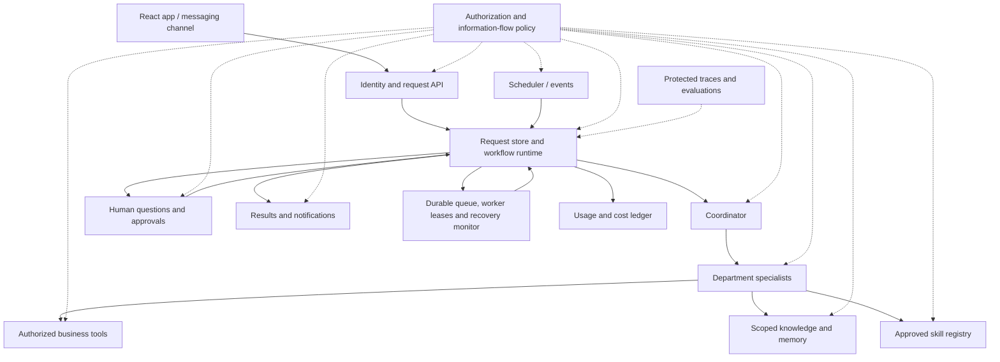
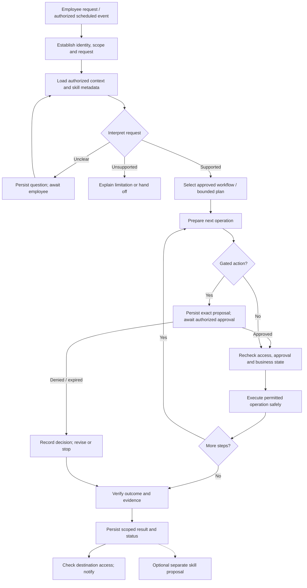
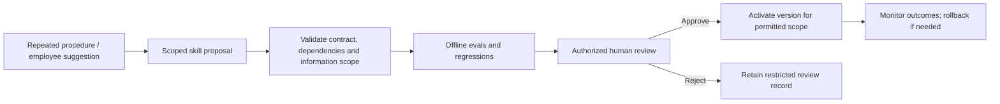

# SE373 Business Ops Agent · team architecture proposal

**Status:** proposal for team review; not an accepted ADR. **Tracking:** [#16](https://github.com/zAcherttp/se373-bizops/issues/16). **Date:** 2026-10-15.

This proposal consolidates the brainstorming session, the supplied topic description, the teammate's workflow image, and research into Hermes and DeepSeek Harness/Cordis. It proposes the final system target and a phased delivery path. It does not claim that these capabilities are implemented.

The desktop rubric draft and research changes on `14-transcript-research` have not been transferred to this cloud checkout. The uploaded `SE373.tldr` has now been inspected and updated: three current proposal pages precede three preserved reference pages. See [board notes](TLDRAW-UPDATE.md). No company or use-case selection below is already agreed.

## 1. Product and scope

Build an internal operations coworker that helps employees complete work and coordinate departments. Employees retain responsibility, business judgment and approval authority. The system retrieves evidence, prepares proposals, executes permitted actions, tracks progress and escalates exceptions.

Demonstrate it with a fictional company. Company configuration describes departments, roles, policies, enabled capabilities and connector bindings. A second small configuration can demonstrate adaptation of an existing workflow without rewriting it. New business processes or external systems may still need development.

A 500-person company is a target scenario, not a claim of 500 concurrent users. Capacity claims require a stated workload and measurements.

### Required topic coverage

- Coordinator and Sales, Marketing, HR, Accounting, Customer Support and Operations specialists.
- Delegation through Telegram, Slack or Discord, alongside the React application.
- Cited internal-procedure Q&A, scheduled reports and company memory across sessions.
- Proposed new skills activated only after human approval.
- Department/resource permissions and human approval before spending.

### Initial scope exclusions

No full ERP, real payroll/tax compliance, autonomous company management, untrusted plugin marketplace, unrestricted shell access, or universal adaptation to arbitrary companies. Visual product matching and decision models are optional experiments after mandatory workflows have a delivery path.

## 2. Proposed decisions

| Decision | Rationale |
|---|---|
| Python/LangChain/LangGraph backend; React/TypeScript/Vite app | Matches the established stack and course gates |
| One shared service, isolated identity and context for every request | Shared infrastructure must not become shared access |
| Durable employee requests separated from chats and run attempts | Work must remain trackable across conversations, waits and failures |
| Small trusted core with pluggable business capabilities | Supports team ownership and company configuration without building a general plugin platform |
| Narrow typed tools and progressive skill loading | Keeps capability, cost and evaluation manageable |
| Approved workflows first; bounded planning later | Makes important business processes explainable and replayable |
| Authorization, money approval and state transitions enforced in code | Model output cannot establish authority or correctness |
| Durable task admission, recovery and escalation | Accepted work must never disappear silently when a process stops |
| Auditable usage and operating-cost ledger | Every execution attempt contributes to attributable, reconcilable cost |
| Protected traces and rerunnable evals accompany every use case | Required evidence is built with the feature |

These are proposed team decisions. Record accepted decisions through the repository's Decision issue → ADR → PR → human review workflow.

## 3. System structure



Dashed links represent mandatory controls, not optional advice to the model. Traces cover the full execution path. The diagram is a final target: persistence/RAG/workflow and multi-agent capabilities are introduced only at their course gates.

| Component | Owns |
|---|---|
| Interfaces | Submission, progress, questions, approvals, result and evidence views |
| Identity/policy | Verified employee identity, resource/action authorization, audience validation |
| Request runtime | State transitions, attempts, budgets, waiting, cancellation, recovery and handoffs |
| Coordinator | Request interpretation, permitted routing and synthesis of permitted results |
| Specialists | Department procedures and focused tasks under delegated limits |
| Tool gateway/connectors | Input validation, policy checks, business API calls and operation receipts |
| Knowledge/memory | Scoped retrieval, provenance and explicitly permitted persistence |
| Skill registry | Discovery, versioning, proposals, review, activation and rollback |
| Scheduler/delivery | Authorized recurring execution and separately tracked notifications |
| Recovery monitor | Detect overdue work, reclaim abandoned attempts, reconcile uncertain actions and escalate |
| Usage/cost ledger | Meter attempts and services, enforce spending budgets, estimate and reconcile charges |
| Evaluation/trace | Outcome evidence, policy events, regression comparison and restricted inspection |

These are logical boundaries, not ten microservices. Start with one Python application; introduce a background worker/process when durable execution needs it. Avoid distributed deployment complexity without measured need.

## 4. Composition inspired by Cordis

Borrow explicit service contracts, dependency declaration, lifecycle cleanup and configuration-driven composition. Implement a small Python package registry; do not port Cordis or replace LangGraph.

### Trusted core

Identity, authorization enforcement, approval enforcement, request lifecycle and audit guarantees cannot be disabled by department plugins. Implementations may have adapters, but required controls remain mandatory. A failure to resolve policy denies access.

### Extension points

- Department packages: tools, approved skills, supported request types and workflow registrations.
- Connectors: catalog, inventory, CRM, accounting and other authoritative systems.
- Channel adapters: app and one selected messaging platform.
- Retrieval/storage adapters: authorized document search and scoped persistence.
- Model adapters: existing profiles plus optional measured classification backends.

A package declares its identifier/version, dependencies, provided capabilities, required permissions, configuration schema and supported phase. Registration validates dependencies and rejects duplicate capability IDs or unsupported phases. Permission declarations request grants; authorized configuration supplies them. Loading code does not grant access.

Configuration selects reviewed, pinned packages. Begin with startup registration; hot reload is out of scope. If a package is disabled, stop new admissions and explicitly drain, cancel or migrate active requests while preserving history. Never silently resume an old request against an incompatible workflow or skill version.

All initial plugins are trusted, reviewed application code. An in-process Python plugin is not a sandbox: untrusted extensions would require separate execution, restricted credentials and a dedicated threat assessment.

### Suggested eventual layout

```text
agent/src/bizops/
  core/                 # existing models, JSON adapter, skills, trace
  runtime/              # identity context, policy enforcement, requests, approvals
  extensions/           # contracts, registry, dependency/phase validation
  departments/          # six specialist packages, introduced at permitted gates
  workflows/            # versioned business workflows, phase 2 onward
  connectors/           # typed authoritative business-system adapters
  knowledge/            # scoped RAG and memory, phase 2 onward
  channels/             # API and selected messaging adapter
  evaluation/           # datasets, outcome checks, regression reports
app/                    # employee request and approval experience
company/                # fictional data, organization and policy configuration
```

This is a navigation proposal, not a request to create empty infrastructure folders. Add abstractions as real use cases require them.

## 5. Requests, execution and human control

A request contains requester, company, responsible owner/department, goal, completion conditions, resource references, policy provenance, workflow/skill versions and linked execution attempts. Runs record tool operations, budget usage, checkpoints and evidence. Conversations can contain multiple requests; each event must resolve to the correct request and authorized participants.

**Request states:** submitted → queued → running → completed. Additional states: awaiting information, awaiting approval, blocked, failed and cancelled. Waiting is persisted rather than represented by a model call remaining open. Human takeover pauses automation; only an authorized resume restarts it.



- Denial or expiry is a business outcome, not permission to retry the same action until approved.
- Spending approval binds action/version, amount/currency, requester, authorized approver and expiry. Material changes require fresh approval. The model cannot write approval state.
- Retry only appropriate transient failures within a documented attempt/time/cost budget. Policy denial does not trigger model fallback to bypass controls.
- Side-effecting calls use operation IDs, idempotency support and/or reconciliation. Ambiguous remote outcomes require checking the business system before replay.
- Cancellation cannot undo an already committed external action; show its actual outcome and any authorized compensation required.
- Task completion, business rejection, execution failure and notification failure are different outcomes.

### Durable execution contract: no silent abandonment

An accepted request always has a persisted owner, state, last progress time and next action. It is actively executing, waiting with a reason and review deadline, or terminal with an evidenced result or failure. Waiting for a person is not completion. Failures create a durable escalation assigned to a responsible employee; success creates a durable notification intent. Explicit authorized cancellation remains a distinct recorded outcome.

This is a recoverability requirement, not a promise that processes never crash. The system must discover interrupted work after service restoration and either resume safely or visibly escalate it. A model need not run continuously: workers execute bounded attempts, while durable state carries the task across waits and restarts.

| Boundary | Required behavior |
|---|---|
| Admission | Persist the request and dispatch intent before acknowledging acceptance. Deduplicate inbound channel/event IDs; return the existing request for retries. If persistence fails, do not acknowledge acceptance |
| Dispatch | Use a durable queue or transactional outbox with replayable dispatch. A crash between saving the request and enqueueing it cannot lose the work |
| Execution ownership | Claim work atomically with an expiring lease, attempt ID and ownership token; renew heartbeats. Reject writes from stale workers after another worker reclaims the request |
| Progress | Checkpoint completed steps, operation receipts, pending work and workflow/skill versions. Record progress separately from lease liveness: a live heartbeat alone does not prove useful progress |
| Model/provider interruption | Apply timeouts and bounded backoff. Reuse persisted completed results where safe; account for all attempts, including interrupted calls with uncertain usage |
| External side effects | Persist intent and stable operation ID before execution. After an ambiguous result, query/reconcile the external system before replay. Exactly-once effects require downstream support; never assume them |
| Human wait | Persist the question/approval, intended responder and deadline; release the worker. Recheck authorization and current business state on resume |
| Recovery | On startup and periodically, scan expired leases, queued work beyond its deadline, stalled progress, overdue human waits and unsent outcomes. Reclaim safely or escalate incompatible/uncertain work |
| Completion | Commit verified outcome and notification intent together. Delivery failure does not rerun the business workflow |
| Escalation | Persist reason, safe evidence, last successful step, uncertain side effects, owner and next action. Retry alert delivery separately; show unresolved escalations in the app |

Use consistent attempt, elapsed-time, no-progress and cost limits. Exhaustion becomes an assigned escalation, not an endless retry loop. Notification attempts also have explicit retry/expiry rules; failed delivery remains visible until resolved. Pending approvals and clarification requests have reminders and an escalation deadline rather than indefinite invisible waits.

The request record is the business lifecycle authority; the queue carries dispatch and LangGraph checkpoints carry execution position. Link them by request/run IDs and define transactional or replayable synchronization. Workflow upgrades require compatible resume or explicit migration/handoff.

The team must select heartbeat, lease, scan, maximum-stall, waiting and delivery thresholds before acceptance tests. Define recovery objectives and backup/restore procedures, including reconciliation of external effects after restoration. A self-hosted recovery monitor cannot report a total host outage while down: use an external health check for operator alerts, then scan durable work on restart. Loss of durable storage requires the separately tested backup/restore path.

### Auditable usage and operating costs

Provide a cost view per request, run attempt, department, company and billing period. Include failed attempts, retries, subagents, decision models, summarization, embedding/indexing, skill review and scheduled work. Keep authorization-aware access to cost metadata; even request descriptions or usage patterns may reveal confidential work.

| Cost category | Metering and accounting |
|---|---|
| Models | Provider/model/version, provider request ID, input/output and provider-specific cached/reasoning usage without double counting, currency and effective pricing version |
| Tools and external APIs | Billable calls, units, duration and applicable plan/tier |
| Hosting and workers | Actual host/service charges, runtime or reserved capacity; distinguish shared idle cost from marginal request cost |
| Storage and retrieval | Database/vector storage, backups, embedding ingestion, retrieval services and retention |
| Network and other services | Egress, notifications and other metered charges where applicable |

Use append-only usage/charge events with stable IDs for deduplication; adjustments and reconciliation add correction entries. Capture provider usage as soon as available, independent of business success. Never record unavailable usage as zero: mark it unknown/pending and reconcile through provider records when possible. Do not replay a paid call solely to obtain metering data.

Use decimal arithmetic or integer subunits with sufficient precision; never binary floating-point money. Preserve sub-cent line items, aggregate before display rounding, and show totals to cents using a declared rounding rule. Preserve original billing currency; a VND view uses a recorded exchange rate/date and does not alter the source-currency ledger.

Show separate **estimated**, **provider-reported usage**, **invoice-confirmed charges** and **allocated shared costs**. Metered estimates use an effective-dated price catalog including caching, batching, tiers and discounts where applicable. Invoice reconciliation accounts for credits, subscription fees, tax, rounding and FX differences; unmatched differences stay explicit. Exact cents are supportable for reconciled bills, not guaranteed for an in-flight estimate or an arbitrary shared-cost allocation.

The calculator exposes direct request cost and total operating cost, with allocation assumptions. Shared infrastructure is counted once in the total; attribution to departments/requests must not double count it. Forecasts show their workload assumptions and uncertainty. Infrastructure/vendor pricing remains a deployment decision.

Before dispatching billable work, reserve a conservative budget atomically against request/department limits, accounting for concurrent attempts; settle against observed usage. Bound tokens, time, parallelism and maximum attempts to limit overrun. If the remaining budget or usage is uncertain, pause/escalate according to policy. These controls cannot promise an exact hard cap where a provider can incur unreported in-flight charges. Agent model-cost budgets are distinct from human approval for business spending; neither grants the other.

## 6. Privacy, memory and information flow

### Core invariant

A derived artifact is accessible only if the reader satisfies every applicable source policy and any additional restrictions. Summarization, redaction or a model's assertion does not declassify information. Policies are resource/action aware; department membership alone is insufficient.

The backend constructs a trusted execution context from authenticated identity. Model arguments cannot override employee identity, company, privileges or approval state. A specialist never gains authority by being named HR or Finance. Scheduled jobs have an explicit owner and approved scope, rechecked on every run; service-account jobs need separately authorized grants.

### Acting on behalf of an employee and recording authority

Every coordinator and department specialist execution acts on behalf of an identified employee or an explicitly authorized scheduled-job principal. Record the requester separately from the executing agent. Department specialization determines available expertise; it does not supply employee privileges.

The server constructs effective authority from the principal's current grants, the workflow's permitted capabilities, resource policies and any action-specific approval. Tool discovery exposes only authorized names, descriptions and schemas. Execution independently rechecks the tool, arguments, target records and current policy: knowing a tool name or seeing it earlier is not authorization.

Delegation carries the originating principal, request/run IDs, parent execution and explicit capability/resource limits. Child authority can be narrowed but never expanded through a specialist handoff. Resume and delivery recheck current permissions rather than treating the original scope snapshot as a permanent grant.

The protected structured audit ledger links:

- Requester/principal and executing coordinator or specialist identity.
- Request, run attempt, parent delegation and tool operation IDs.
- Effective scope or its immutable versioned reference, policy version, authorization decision and relevant resource versions/references.
- Approval reference, authorized approver and approved action version where required.
- Operation receipt, outcome, escalation and linked usage/cost event IDs.

Record authorization before dispatch and the observed outcome afterward. Missing post-execution evidence is an explicit unknown requiring reconciliation, not proof of success or failure. Protect audit integrity with restricted append access and correction events; never let model output author its own authorization evidence. Ledger readers are themselves authorized, and evidence must support reconstructing the decision without publishing sensitive payloads broadly.

Conversation transcripts record interaction; structured audit events record authority and observed actions; cost events record usage and charges. Link these records, but do not use a transcript alone as the audit ledger or promise to retain every confidential payload. Redaction, retention and access controls apply to each record type. This is execution accountability, not a requirement to collect hidden model reasoning.

### Storage boundaries

| Store | Allowed purpose and protection |
|---|---|
| Business systems | Authoritative sensitive records; row/field access checked on each action |
| Company knowledge | Explicitly published all-employee procedures |
| Restricted knowledge | Resource-scoped documents/chunks/embeddings; filter before prompt construction |
| Employee memory | Permitted personal context, scoped to its owner and intended use |
| Request state | Case facts, checkpoints and summaries restricted by source policies and participants |
| Department memory | Explicitly authorized shared knowledge, not automatic transcript accumulation |
| Skills | General procedures; discovery metadata and linked files are access-controlled too |
| Traces/caches/exports | Minimized, access-controlled and subject to retention/invalidation |

Prefer references over copied sensitive values where practical. Protect filenames, snippets, citation metadata and existence as well as document bodies. Search authorization applies before results enter model context. Recheck access on resume, cached reads and delayed delivery; permission revocation must invalidate affected derivatives. Cross-user model contexts or caches must never reuse private material without matching authorization.

Group-chat authorization considers recipients, not only the requester. Deliver sensitive results through an authorized private view and send a generic completion notification if needed. Provider retention, telemetry, backups and deletion need explicit deployment policies before confidential data is used.

**Payroll example:** authorized HR analysis stays restricted in its result, history, memory and traces. It cannot feed shared skill learning. Sales cannot recover it through summaries, search metadata, cached answers or repeated aggregate queries. Publishing an aggregated result requires its own approved disclosure policy.

## 7. Skill lifecycle



Skill approval never grants tool privileges. Proposals derived from restricted work remain restricted until an authorized publication process establishes a safe generalized version. Use placeholders and runtime authorized tool calls instead of real employee/customer examples. PII scanners are additional checks, not proof of safety.

Initially propose instruction changes using existing tools. New executable tools/connectors are code changes that follow issue/PR/review; skill generation cannot invent a missing integration or modify enforcement policy. Production workflows do not depend on immediate skill generation to finish an unsupported task.

## 8. Five use cases and team ownership

**Proposed portfolio for discussion, not a finalized selection:**

| Owner slot | Outcome | Earliest phase | Required capabilities covered |
|---|---|---|---|
| A | Operational briefing, initially on demand and later scheduled | 1 for on-demand slice | Tool use, reusable skill, reporting, schedule, chat delivery |
| B | Internal procedure assistance with citations and scoped recall | 2 | RAG, persistent company context, memory, permissions |
| C | Spending request checked, approved/rejected, resumed and recorded | 2 | LangGraph workflow, human approval, persistence, accounting |
| D | Cross-department service/fulfillment exception resolved or escalated | 3 | Coordinator, department specialists, bounded handoffs |
| E | Repeated procedure proposed as a skill, evaluated and approved before reuse | 3 | Skill evolution, review, regression and scoped publication |

Five workflows must collectively exercise all six required departments; six specialists do not require six use cases or separate deployments. Select concrete departmental contributions after choosing the company. Assign real owners only after team agreement.

Each person owns the business scenario, data, tools, app flow, demo, evals and traces for one outcome. In Phase 1 everyone contributes to the first vertical slice. Also name a maintainer and reviewer for each shared runtime/interface; ownership does not allow divergent identity or tool contracts.

Optional visual matching belongs inside a Sales/Support workflow if approved: image/text candidates → attribute/compatibility checks → catalog identity evidence → current stock/date availability and pricing → customer confirmation. Similar appearance never proves exact identity. It must not displace required topic coverage.

## 9. Phase plan and acceptance

| Gate | Deliverable | Demonstration |
|---|---|---|
| Phase 1 · Oct 27 | One app-to-agent use case, ≥2 tools, 1 skill, step logs, ≥10 evals; synthetic data and basic identity boundaries | Submit a request, inspect evidence, observe correct success and controlled failure |
| Phase 2 · Nov 10 | ≥3 use cases, cited RAG, scoped persistence/resume, context handling, LangGraph human approval; durable admission, worker recovery and cost-ledger persistence | Kill/restart a running or waiting workflow; resume or escalate visibly without duplicate action; display attempt costs |
| Phase 3 · Dec 6 | ≥5 use cases, multi-agent/MCP, security, complete evals/traces and final deliverables; recovery fault tests and full operating-cost view | Cross-department workflow, safe denial, approved skill reuse, outage recovery, reconciled cost evidence and regression results |

Do not introduce later-course features through a bundled framework in Phase 1. A modular tool/skill registry is useful without implementing multi-agent early.

**Phase 1 candidate:** an on-demand operational briefing using two distinct domain tools plus one reporting skill. Weekly sales reporting is an option, not an agreed business choice. Keep initial records read-only and synthetic; add scheduled delivery at the permitted gate.

In Phase 1 define request/run/usage IDs, capture available model usage with pricing-based estimates, and surface timeout/error outcomes. Full durable recovery and the final always-on claim wait for Phase 2 persistence and its acceptance evidence; avoid implying the Phase 1 process already survives crashes.

For final planning, provisionally include ≥2 reusable skills, a ≥3-node workflow, ≥5 evals per use case plus 5 attack cases, and two regression runs. These came from the user's untransferred rubric summary. Correct mapping is K6 = multi-agent/MCP and K7 = evaluation; exact remaining K wording and rubric details need source reconciliation. Do not silently treat the existing K7=MCP table as current.

## 10. Verification and scale

For each use case, define expected tool effects, evidence, permitted readers, failure behavior and demo fixtures. Tests use synthetic data and scripted models without network/keys; model evaluations are separately configured and report provider/profile, dataset and code version. Distinguish fake-model harness tests from evidence of live-model capability. Compare the same eval dataset across regression runs and retain differences.

At minimum test unauthorized payroll retrieval, restricted-to-shared memory/skill contamination, document prompt injection, approval bypass and cross-user leakage. Also test revocation before resume/delivery, guessed resource IDs, group-chat exposure, duplicate execution and unknown remote outcomes. Inspect stored artifacts, not only final answers. Current scaffold traces record raw payloads and skill loading has no user-scope enforcement; these must be addressed before sensitive data.

**Recovery acceptance:** inject process termination after admission/before dispatch, during execution, after an external action/before its receipt is saved, while awaiting approval, and after completion/before notification. Also test duplicated ingress, stale workers, provider outage, storage outage, exhausted budgets and failed escalation delivery. Once dependencies recover, every accepted request must remain discoverable and become safely resumed, explicitly waiting with a deadline, or terminal with success/cancellation/failure evidence. Failures have assigned escalations; uncertain external effects are reconciled rather than blindly repeated. Verify actual business records for duplicate actions.

**Cost acceptance:** use synthetic pricing and usage fixtures with sub-cent charges, cached-token rules, retries, failed calls, duplicate events, unknown usage, currency conversion and invoice corrections. Assert deterministic arithmetic, no duplicate charges, transparent unknowns, and totals matching fixture bills under the declared rounding rule. Concurrent budget tests must show atomic reservations. Shared allocations must reconcile to the operating total without counting infrastructure twice. Real billing evidence is a separate check from offline fixtures.

For scale, specify daily users, peak request arrivals, overlapping runs, catalog/document size, model limits and response targets before choosing infrastructure. Measure queue wait, completion latency, error rate, model/tool cost and delivery success under a representative workload. Bound concurrency, retries and per-request budgets; use scheduling fairness so one large job cannot starve others. No 500-user capacity claim is established yet.

Decision-model experiments compare routing/escalation accuracy, unsafe false acceptance, latency and cost against rules and structured-output LLMs. Model failure escalates or uses an approved fallback; mandatory controls remain deterministic.

## 11. Relationship to existing proposals and references

The teammate's supplied flow contributes clarification, single/multiple specialist routing, parallel dependent work, human approval and validation. Preserve it as a detailed execution example. Add request durability, repeated authorization, safe side effects and scoped learning. Unknown requests must not automatically create skills; generalist fallback must not broaden privileges.

Hermes informs gateway separation, progressive skills, bounded delegation, durable Kanban collaboration and scheduled delivery. Cordis informs composition, dependencies and lifecycle. We adopt selected principles in Python; neither system is the mandatory runtime or a proven business-security boundary.

Primary references inspected during this session:

- [Hermes architecture, pinned source](https://github.com/NousResearch/hermes-agent/blob/dfa79389773271ee78c41a7af340848948d461ee/website/docs/developer-guide/architecture.md)
- [Hermes durable task collaboration, pinned source](https://github.com/NousResearch/hermes-agent/blob/dfa79389773271ee78c41a7af340848948d461ee/website/docs/user-guide/features/kanban.md)
- [DeepSeek Harness architecture](https://github.com/deepseek-ai/deepseek-harness/blob/master/docs/architecture.md)

Repository links: [requirements](YEU-CAU.md), [research](NGHIEN-CUU.md), [team workflow](QUY-TRINH.md), [ADR process](decisions/README.md). This proposal supersedes neither an accepted ADR nor course rules.

## 12. Team decision agenda and next work

1. Accept/amend product scope, shared-service isolation and the component boundaries.
2. Accept/amend trusted-core/plugin contracts; keep hot reload and untrusted plugins out of initial scope.
3. Choose the fictional company and validate its core workflows with a few people familiar with the work.
4. Select five use cases, assign owners/reviewers, and confirm coverage of every topic obligation and six departments.
5. Select the messaging channel and the Phase 1 vertical slice with observable completion conditions.
6. Choose identity, storage/checkpointer, background execution and retrieval implementations at the phase where needed. LangGraph checkpointing and business request state must not become conflicting sources of truth; define their IDs and synchronization contract.
7. Decide provider data handling, disclosure policy and retention before introducing confidential information.
8. Reconcile the rubric draft after transfer. Review the updated `SE373.tldr` alongside this proposal; the three original pages remain reference material, not accepted decisions.
9. Record accepted decisions in Decision issues and ADRs, then create small implementation issues and task branches.
10. Set recovery objectives, lease/heartbeat and waiting deadlines, escalation owners, backup/restore and external health monitoring. Select the dispatch/checkpoint synchronization contract.
11. Define the cost catalog, invoice import/reconciliation method, allocation and rounding policies, visibility permissions and budget limits. Set measurable calculator and recovery acceptance criteria before implementation.

Updated editable board: [SE373.tldr](SE373.tldr). Preservation, page mapping and validation are documented in [TLDRAW-UPDATE.md](TLDRAW-UPDATE.md).

Board layout after agreement: (1) system architecture and trust boundaries, (2) request lifecycle plus one concrete business workflow, (3) skill proposal/activation lifecycle. Annotate phase gates and distinguish implemented capabilities from future targets.
