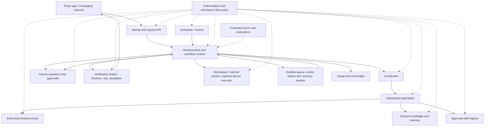
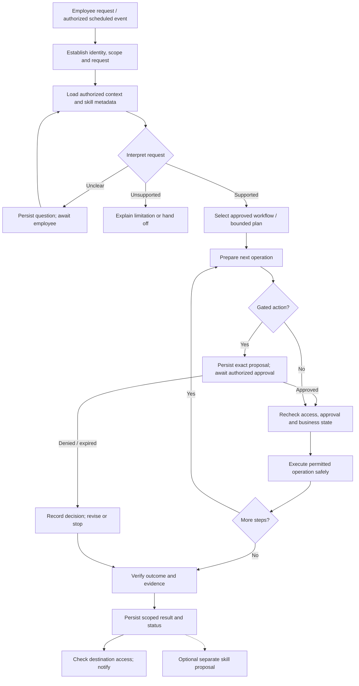
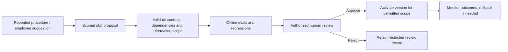

# SE373 Business Ops Agent · team architecture proposal

**Status:** proposal for team review, not an accepted ADR. **Tracking:** [#16](https://github.com/zAcherttp/se373-bizops/issues/16); workspace/notification additions per [Decision #18](https://github.com/zAcherttp/se373-bizops/issues/18) in [PR #17](https://github.com/zAcherttp/se373-bizops/pull/17). **Date:** 2026-10-15. **Updated:** 2026-10-17.

Inputs: the brainstorming session, the topic description, the teammate's workflow image, and research into Hermes, DeepSeek Harness/Cordis and Pi Durable. Rubric draft v3 and the always-on agents research (branch `14-transcript-research`, PR #15) shape §8, §9 and §11. The board [SE373.tldr](SE373.tldr) shows it on six pages: overview, architecture, durable requests, skills and phases, feature map with roadmap, workspace/notification deployment.

**Defaults for every section:**

- Nothing here is implemented or agreed, including company and use cases. YAML and workflow examples are illustrative, not connector guarantees.
- Authorization, approval, money controls and state transitions are enforced in code. Model output never establishes authority, approval or correctness.
- Initial plugins are trusted, reviewed code. An in-process plugin is not a sandbox; neither is a VM.
- Capabilities arrive only at their course gate (§9); diagrams show the final target.
- "No silent abandonment" is a measured lifecycle goal under a declared fault model, not 100% business success or failure-free infrastructure. Waiting is not completion.
- Metrics are reported separately:
  - business success, with evidence;
  - lifecycle coverage: valid state, owner, next action;
  - recovery per fault scenario: detection and recovery time, duplicates;
  - blocker resolution: wait time, reminders, ack/resolve rate, delivery failures, unowned escalations;
  - cost/load (CPU/RAM/traffic, tokens, device use, VM idle/startup/storage) versus a server-only baseline on the same workload and quality bar.

## 1. Product and scope

An internal operations coworker. Employees keep responsibility, judgment and approval authority; the system retrieves evidence, prepares proposals, executes permitted actions, tracks progress and escalates exceptions.

The demo company is fictional. Configuration sets departments, roles, policies, capabilities and connector bindings; a second small configuration can show a workflow adapted without rewriting (new processes or systems may still need code). A 500-person company is a target scenario, not 500 concurrent users; capacity claims need a stated workload and measurements.

**Required coverage:**

- Coordinator plus Sales, Marketing, HR, Accounting, Customer Support and Operations specialists.
- Delegation via Telegram, Slack or Discord besides the React app.
- Cited procedure Q&A, scheduled reports, company memory across sessions.
- Proposed skills activated only after human approval.
- Department/resource permissions; human approval before spending.

**Excluded initially:** full ERP, real payroll/tax compliance, autonomous company management, untrusted plugin marketplace, unrestricted shell, adapting to arbitrary companies. Visual product matching and decision models are optional experiments once mandatory workflows have a delivery path.

## 2. Proposed decisions

- Python/LangChain/LangGraph backend; React/TypeScript/Vite app.
- One shared service, isolated identity and context per request.
- Durable requests separate from chats and run attempts.
- Small trusted core, pluggable business capabilities.
- Narrow typed tools, progressive skill loading.
- Per-tool authorization, approval, recovery and metering contract.
- Approved workflows first, bounded planning later.
- Durable admission, recovery and escalation.
- Workspace independent of the employee device; brokered blocker notifications.
- Auditable usage and operating-cost ledger.
- Protected traces and rerunnable evals per use case.

Accepted decisions follow Decision issue → ADR → PR → human review.

## 3. System structure



Dashed links are mandatory controls; traces cover the whole path. Scheduler, broker and executors are detailed in §5.

These are logical boundaries in one Python application, not microservices. Add a background worker when durable execution needs it; nothing distributed without measured need.

## 4. Composition inspired by Cordis

Borrow Cordis's service contracts, dependency declaration, lifecycle cleanup and configuration-driven composition as a small Python registry; do not port Cordis or replace LangGraph.

- **Trusted core:** plugins cannot disable identity, authorization, approval, request lifecycle or audit. Unresolved policy denies.
- **Extension points:** department packages (tools, skills, request types, workflows) and connectors (catalog, inventory, CRM, accounting). Also channel adapters (app plus one messaging platform), retrieval/storage adapters and model adapters (existing profiles, optional measured classifiers).
- **Manifest:** ID/version, dependencies, capabilities, requested permissions, config schema, supported phase. Registration rejects missing dependencies, duplicate capability IDs and unsupported phases. Only authorized configuration grants permissions.
- **Lifecycle:** reviewed, pinned packages loaded at startup; no hot reload. Disabling one stops admissions and drains, cancels or migrates active requests, keeping history; never resume on an incompatible workflow or skill version. Untrusted extensions would need separate execution, restricted credentials and a threat assessment.

### Business tool execution contract

The gateway validates each versioned contract at registration and enforces it on model, nested, specialist and recovery calls. Filtered discovery is not the permission boundary. Missing policy denies; missing recovery metadata forbids replay.

| Field | Meaning |
|---|---|
| Identity and schemas | Stable ID, input/output schemas, contract version, compatible workflow versions |
| Authorization | Action/resource permissions; server-provided principal, record/field constraints; output classification |
| Approval | Whether approval is required; binding of exact arguments/version to the approval record |
| Recovery | Replay category, idempotency, lookup/reconciliation, escalation path |
| Limits | Timeout, bounded retries, concurrency, cancellation; committed effects may need compensation |
| Placement | Allowed locations, local input, fallback, data residency/transfer, runtime/image version, deadline, resources, output verification |
| Evidence | Intent, operation ID, receipt, observed state, policy/approval references |
| Metering | Usage units/source, charge-event ID, pricing reference, unknown-usage handling |

Connectors declare idempotency/lookup only after their backend passes the tests.

```yaml
name: create_purchase_order
contract_version: 1
required_permission: purchasing.create
approval_required: true
recovery:
  replay: reconcile_first
  idempotency_supported: true
  lookup_by_operation_id: true
execution:
  allowed_locations: [server, employee_device]
  requires_local_input: false
  fallback: server
```

Recovery categories:

- **`safe_to_repeat`:** repeating causes no extra harm. Reads may qualify, but answers change: reuse the committed result when the workflow needs the original. Reads still cost and need current authorization.
- **`reconcile_first`:** the effect may exist. Look up by operation ID, persist the receipt, retry only once safe. Prefer backend idempotency; an inconclusive lookup does not prove absence.
- **`human_resolution_required`:** no reliable lookup/idempotency, or ambiguity remains. Block and escalate; never blindly repeat.

An interrupted call is **unknown** until reconciled: a crash after purchase submission but before the receipt is saved means lookup, not a second order. Reauthorize before reconciling or acting; if authority was revoked, escalate to an authorized owner. Receipts and cost events are durable. Retries share the operation ID with new attempt/usage IDs. Children record their own usage and parents reference it without double charging. Unknown usage stays pending, never zero; never repeat a paid call to learn its usage.

### Runtime ownership and Pi Durable

Keep LangGraph; borrow Pi Durable's contracts, not its engine. The request store owns the visible lifecycle, dispatch/recovery owns scheduling, LangGraph owns workflow position, business systems own actual effects, linked by request/run/operation IDs and transactional or replayable transitions. Persist before reporting accepted/completed; streamed text is provisional. A subscriber disconnecting cancels nothing (cancellation is an authenticated command); parent/child ownership leaves no orphaned work. Human waits release workers; process recovery is not rollback of business effects.

We read the pinned Pi Durable [README](https://github.com/earendil-works/pi/blob/8efd314fa3d3232ce197d8d7a6a5660530b9d83e/packages/durable/README.md) and [spec](https://github.com/earendil-works/pi/blob/8efd314fa3d3232ce197d8d7a6a5660530b9d83e/packages/durable/docs/spec.md) (no benchmark): it is experimental single-process TypeScript without our leases, HA, backups or mandatory policy. Wrapping LangGraph in it would duplicate task, cancellation and checkpoint ownership, so adoption needs its own ADR.

### Suggested eventual layout

```text
agent/src/bizops/
  core/                 # existing models, JSON adapter, skills, trace
  runtime/              # identity context, policy enforcement, requests, approvals
  extensions/           # contracts, registry, dependency/phase validation
  departments/          # six specialist packages, introduced at permitted gates
  workflows/            # versioned business workflows, phase 2 onward
  connectors/           # typed authoritative business-system adapters
  knowledge/            # scoped RAG and memory, phase 2 onward
  channels/             # API and selected messaging adapter
  evaluation/           # datasets, outcome checks, regression reports
app/                    # employee request and approval experience
company/                # fictional data, organization and policy configuration
```

A navigation aid, not a request for empty folders.

## 5. Requests, execution and human control

A request holds requester, company, owner/department, goal, completion conditions, resource references, policy provenance, workflow/skill versions and attempts; runs record tool operations, budget use, checkpoints and evidence. One conversation can hold several requests, and each event must resolve to the right request and participants.

**States:** submitted → queued → running → completed, plus awaiting information, awaiting approval, blocked, failed, cancelled. Waits are persisted, never open model calls. Human takeover pauses automation until an authorized resume.



- Denial or expiry is an outcome, not a reason to retry until approved.
- Spending approval binds action/version, amount/currency, requester, approver and expiry; material changes need fresh approval.
- Retry only transient failures within an attempt/time/cost budget; policy denial never triggers a model fallback.
- Cancellation cannot undo committed effects; show the real outcome and any authorized compensation.
- Completion, business rejection, execution failure and notification failure are distinct outcomes.

### Durable execution: no silent abandonment

Every accepted request has a persisted owner, state, last progress time and next action: executing, waiting with reason and deadline, or terminal with evidence. Failure creates an assigned escalation; success creates a notification intent; cancellation is its own outcome. After a crash, the system finds interrupted work and resumes safely or escalates visibly. Workers run bounded attempts; durable state carries tasks across waits and restarts.

| Boundary | Required behavior |
|---|---|
| Admission | Persist request and dispatch intent before acknowledging; dedup inbound IDs; no ack if persistence fails |
| Dispatch | Durable queue or transactional outbox; a crash between save and enqueue loses nothing |
| Ownership | Atomic claim: expiring lease, attempt ID, ownership token, heartbeats; reject stale-worker writes |
| Progress | Checkpoint steps, receipts, pending work, versions; liveness is not progress |
| Provider interruption | Timeouts, bounded backoff, reuse saved results, account for every attempt |
| Side effects | Persist intent and operation ID first; reconcile before replay; exactly-once only with downstream support |
| Human wait | Persist question, responder, deadline; release worker; recheck access and business state on resume |
| Recovery | At startup and periodically scan expired leases, overdue queue items, stalls, overdue waits, unsent outcomes; reclaim or escalate |
| Completion | Commit outcome and notification intent together; delivery failure never reruns the workflow |
| Escalation | Reason, safe evidence, last good step, uncertain effects, owner, next action; alerts retried separately; visible in the app |

Attempt, elapsed-time, no-progress and cost limits end in an assigned escalation, not a loop. Notifications have retry/expiry rules; approvals and clarifications get reminders and an escalation deadline. Hard failures carry error code, reason, evidence, owner and next action; missing information, missing permission, transient error, device loss, unknown external outcome and unsupported request are classified separately.

The request record is lifecycle authority, the queue carries dispatch, LangGraph checkpoints carry position. Workflow upgrades need compatible resume or explicit migration. Before acceptance tests, set heartbeat, lease, scan, stall, waiting and delivery thresholds, recovery objectives and backup/restore (including reconciling effects after restore). A self-hosted monitor cannot report its own host outage: an external health check alerts operators, and work is rescanned on restart.

### Workspaces, devices, notifications and deployment

The server decides identity, policy, approval and lifecycle; executors only run work items. A **browser worker/WASM** handles employee-chosen files, parsing, computation, preview and benchmarked small models, but may freeze or go offline and holds no shared credentials. An **internal worker near data** runs in-network queries, aggregation and batch with least privilege, never on other employees' machines. A **server workspace** (container/VM) continues after the user leaves; request, checkpoint and policy stay in the core.

Placement follows capability, data location, permissions, resources and measured cost, by rules first; never move data to rescue a task. Offload order: compute at the source → local preprocessing → send only needed evidence → reuse valid artifacts by version/scope → model for reasoning and exceptions. The loop stays on the server. Local work does not lower token cost; cost shifted to a device has not vanished. Work items carry principal, scope, request/run/attempt/operation IDs, input references, version, lease and budget, never broad credentials. Client results are untrusted: verify by effect; they cannot skip approval or prove spending.

**Device loss:** lease expiry sets `blocked` with `waiting_reason=device_offline`, device, owner, checkpoint, next action and deadline. Reconcile in-flight operations. Reassign only to a compatible executor allowed the data (same operation ID, new attempt ID); never copy employee A's data to machine B. Never poll with the model. An authenticated, deduplicated reconnect event resumes after rechecking device, principal, request, permissions and checkpoint version. A fallback timer uses capped, jittered backoff within the deadline, reset on progress. At the deadline escalate to the configured owner; late results from the old device are rejected or reconciled. The scheduler fires persisted timers/events, not polling crons. Waiting on a reply, an approval or a device are separate reasons with their own owners and policies.

**Notification broker:** channels are adapters of one broker, starting with the app inbox plus the course channel; an adapter is not permission to send or export data. A blocker records `blocker_id`, request, type, responder, action, severity, deadline, audience and resolution state (queued, sent, delivered if supported, acknowledged, resolved; no read receipt means unread). Each delivery has its own ID, receipt and dedup key (blocker, recipient, channel, reminder stage); resends create no business work. Channels follow preference, urgency and permission, stepping through fallbacks and reminders, never broadcasting; quiet hours, cooldown, quota and deadlines are configured, and only defined urgent cases bypass quiet hours. Callbacks are authenticated, links grant nothing, approval stays in the workflow. Broad messages carry generic status ("Request R is waiting for a file on your device"), never payroll, documents or sensitive links. Recipient and audience are checked per delivery, and jobs never borrow a revoked creator's credentials.

**Workspace:** an authorized entity (ID, owner/scope, image/tool version, volume/artifact references); a conversation ID never grants filesystem access. The **P3 spike** is one internal Linux VM with a prepared image, Python worker, persistent volume and one workload. It starts after core persistence works, with the request store outside the guest; no VM platform, fleet, or VM per employee or specialist. Before sensitive data: CPU/RAM/disk/time quotas, egress allowlist, short-lived credentials or gateway, image patching. Also per-scope workspaces, retention-based sanitizing, no secrets in snapshots, and health/start/stop/drain with artifacts saved before deprovisioning. Snapshots neither back up business state nor roll back external effects. Structured tools only: no gateway-bypassing shell or GUI, no untrusted code; desktop streaming or computer use only if a use case needs it. A dead guest goes to the recovery monitor; a shared-host outage needs the external alert and backup/restore, which is not high availability.

**Deployment:** one instance per company on its infrastructure, shared code, versioned and reviewed organization/policy/workflow/connector configuration; no multi-tenant SaaS. **Strict on-prem** means internal inference, storage, telemetry and processing with no cloud fallback. External chat channels and model APIs are declared exceptions; ask the lecturer if this conflicts with the chat requirement. Missing internal capacity means wait or escalate, never silent egress. Optional **auto-mapping:** employee CSV and permitted SOPs → sourced draft organization/authority → gaps → ask the owner → diff, validation, dry-run → human activation. Authority is never inferred from titles, access history or model confidence. Browser offloading, local models, auto-mapping and visual matching are candidate experiments: pick one once mandatory coverage and P1/P2 are on track.

### Auditable usage and operating costs

Report cost per request, attempt, department, company and billing period, covering failed attempts, retries, subagents, decision models, summarization, embedding, skill review and scheduled work. Cost metadata is access-controlled because usage reveals work.

| Category | Metered as |
|---|---|
| Models | Provider/model/version, request ID, input/output plus cached/reasoning usage without double counting, currency, pricing version |
| Tools and APIs | Billable calls, units, duration, plan/tier |
| Hosting and workers | Actual charges, runtime or reserved capacity; shared idle cost separate from marginal cost |
| Storage and retrieval | Database/vector storage, backups, embedding ingestion, retrieval, retention |
| Network and other | Egress, notifications, other metered charges |

- Append-only usage/charge events with stable IDs; corrections are new entries. Capture usage regardless of business success; unavailable usage is pending and reconciled from provider records.
- Decimal or integer subunits, never floats. Keep sub-cent items, aggregate before rounding, show cents under a declared rule. Keep the billing currency; a VND view uses a recorded rate and date.
- Show **estimated**, **provider-reported**, **invoice-confirmed** and **allocated shared** costs separately. Estimates use an effective-dated catalog (caching, batching, tiers, discounts); reconciliation covers credits, subscriptions, tax, rounding and FX, leaving differences visible. Exact cents hold only for reconciled bills.
- The calculator shows direct request cost and total operating cost with allocation assumptions; shared infrastructure counts once. Forecasts state workload and uncertainty. Vendor pricing is a deployment decision.
- Reserve a conservative budget atomically (counting concurrent attempts) before billable work and settle on observed usage. Bound tokens, time, parallelism and attempts; uncertain budget pauses or escalates. No exact hard cap where providers bill unreported in-flight usage. Model-cost budgets and business-spending approval never substitute for each other.

## 6. Privacy, memory and information flow

**Core invariant:** a derived artifact is readable only by someone satisfying every source policy plus any extra restriction. Summaries, redaction or model claims do not declassify. Department membership alone is not authorization.

### Acting for an employee and recording authority

The backend builds the execution context from authenticated identity. Every coordinator and specialist run acts for an identified employee or an authorized scheduled-job principal; requester and executing agent are recorded separately. Model arguments cannot change identity, company, privileges or approval state; an "HR" specialist has expertise, not privileges. Scheduled jobs have an owner and scope rechecked every run; service-account jobs need separate grants.

Effective authority is current grants ∩ workflow capabilities ∩ resource policies, plus action approval. Discovery shows only authorized tools; execution rechecks tool, arguments, records and policy. Delegation carries principal, request/run IDs, parent and limits; children can narrow authority, never widen it. Resume and delivery recheck current permissions.

The protected audit ledger links:

- principal and executing agent;
- request, attempt, delegation and operation IDs;
- effective scope (or versioned reference), policy version, decision and resource versions;
- approval reference, approver and action version;
- receipt, outcome, escalation and cost event IDs.

Authorization is recorded before dispatch, outcome after; missing outcome evidence is an unknown to reconcile. Append access is restricted, corrections are events, and the model never authors its own evidence. Ledger readers are authorized; evidence reconstructs decisions without spreading payloads. Transcripts, audit events and cost events are linked but separate, each with its own redaction, retention and access rules; hidden model reasoning is not collected.

### Storage boundaries

| Store | Purpose and protection |
|---|---|
| Business systems | Authoritative records; row/field access per action |
| Company knowledge | Published all-employee procedures |
| Restricted knowledge | Scoped documents/chunks/embeddings, filtered before prompting |
| Employee memory | Personal context for its owner and purpose |
| Request state | Case facts, checkpoints, summaries under source policies |
| Department memory | Authorized shared knowledge, not accumulated transcripts |
| Skills | General procedures; metadata and files access-controlled |
| Traces/caches/exports | Minimized, access-controlled, retained and invalidated by policy |

Prefer references to copies. Protect filenames, snippets, citations and existence, not just bodies. Authorize search before results reach the model; recheck on resume, cache reads and delayed delivery; revocation invalidates derivatives; no cross-user context or cache reuse without matching authorization. Group chats are authorized against all recipients: sensitive results go to a private view with a generic group notice. Provider retention, telemetry, backups and deletion need policies before confidential data.

**Payroll example:** authorized HR analysis stays restricted in result, history, memory and traces, and never feeds shared skills. Sales cannot recover it through summaries, search metadata, caches or repeated aggregates. Publishing an aggregate needs its own disclosure policy.

## 7. Skill lifecycle



- Skill approval never grants tool privileges.
- Proposals from restricted work stay restricted until an authorized publication yields a safe generalized version; use placeholders, not real employee/customer data. PII scanners are extra checks, not proof.
- Proposals change instructions over existing tools. New tools/connectors go through issue/PR/review; generation cannot invent integrations or change policy.
- No production workflow depends on on-the-spot skill generation.

## 8. Five use cases and team ownership

**Proposed portfolio for discussion, not a final selection:**

| Owner slot | Outcome | Earliest phase | Required capabilities covered |
|---|---|---|---|
| A | Operational briefing, on demand first, scheduled later | 1 for on-demand slice | Tool use, reusable skill, reporting, schedule, chat delivery |
| B | Internal procedure assistance with citations and scoped recall | 2 | RAG, persistent company context, memory, permissions |
| C | Spending request checked, approved/rejected, resumed and recorded | 2 | LangGraph workflow, human approval, persistence, accounting |
| D | Cross-department service/fulfillment exception resolved or escalated | 3 | Coordinator, department specialists, bounded handoffs |
| E | Repeated procedure proposed as a skill, evaluated and approved before reuse | 3 | Skill evolution, review, regression, scoped publication |

Together the five must exercise all six departments; six specialists need neither six use cases nor six deployments. Pick departmental contributions after the company and owners after team agreement.

Each person owns one outcome's scenario, data, tools, app flow, demo, evals and traces, written in the rubric's six-part form: description; 1–3 primary K areas; technical requirements; 3–6 measurable acceptance criteria; ≥5 eval cases including ≥1 edge or failure case; a trace of ≥1 successful run. If the course publishes its expected 8–11 candidate use cases per topic, map slots A–E onto them. In Phase 1 everyone builds the first vertical slice. Each shared runtime/interface gets a maintainer and reviewer; no divergent identity or tool contracts.

Optional visual matching, if approved, sits inside a Sales/Support workflow: image/text candidates → attribute/compatibility checks → catalog identity evidence → current stock, availability and pricing → customer confirmation. Similar appearance never proves identity, and it never displaces required coverage.

## 9. Phase plan and acceptance

| Gate | Deliverable | Demonstration |
|---|---|---|
| Phase 1 · Oct 27 | One app-to-agent use case, ≥2 tools, 1 skill, step logs, ≥10 evals; synthetic data, basic identity boundaries; tool contracts, request/run/usage IDs, visible errors | Submit a request, inspect evidence, see correct success and controlled failure |
| Phase 2 · Nov 10 | ≥3 use cases, cited RAG, scoped persistence/resume, context handling, LangGraph human approval; durable admission, worker recovery, cost-ledger persistence; durable blockers, broker with app + one channel, reconnect/backoff, server worker | Kill/restart a running or waiting workflow; resume or escalate visibly without duplicate action; show attempt costs |
| Phase 3 · Dec 6 | ≥5 use cases, multi-agent/MCP, security, complete evals/traces, final deliverables; recovery fault tests, full operating-cost view; one VM/workspace spike if feasible, placement and cost comparison | Cross-department workflow, safe denial, approved skill reuse, outage recovery, reconciled costs, regression results, final demo |

Phase 1 has no bundled framework, VM, multi-agent or distributed runtime; a modular tool/skill registry is fine. No recoverability claim before Phase 2 fault tests. No VM fleet, marketplace, full desktop streaming or compute swarm in Phase 3.

**Phase 1 candidate:** an on-demand operational briefing with two domain tools and one reporting skill; weekly sales reporting is an option, not agreed. Records are read-only and synthetic, usage uses pricing-based estimates, and scheduling waits for its gate. Do not imply Phase 1 survives crashes.

**Final demo:** delegate → workspace runs → laptop closes, work continues → a local file is needed: wait and notify → user reconnects → recheck permissions, reconcile → result with evidence. Restart a worker/guest at a declared point to show no lost request and no duplicate action; live variants stay within tested scope.

**Course rubric draft v3 (2026-10-06; official status unconfirmed):** each use case scores function, harness design and verification at 0.5 each. System-wide: a ≥3-node workflow with stop conditions; an `agent = model + harness` diagram naming ≥4 harness layers plus a failure-mode table; ≥1 external tool and ≥2 reusable skills with full contracts; traces for every run; one-command evals with at least 5 cases per use case plus 5 attack cases (30 for five use cases) and ≥2 regression runs; README, `.env.example`, report, video, use-case ownership table and AI-use disclosure. A tool or skill that runs a dangerous action without an approval gate zeroes that use case's harness score. K areas: K1 model integration/structured output/agent loop/architecture, K2 tools and skills, K3 RAG, K4 memory/state/context, K5 workflow and human-in-the-loop, K6 multi-agent or MCP, K7 verification and evaluation, K8 security/governance/observability; each missing area costs 0.5. Phase 1 still requires ≥10 evals.

## 10. Verification and scale

Each use case defines expected effects, evidence, permitted readers, failure behavior and fixtures. Tests use synthetic data and scripted models without network or keys; model evals report provider/profile, dataset and code version, and fake-model tests are not evidence of live capability. Regression runs reuse one dataset and keep differences.

- **Security:** unauthorized payroll retrieval, restricted-to-shared memory/skill contamination, document prompt injection, approval bypass, cross-user leakage, revocation before resume/delivery, guessed IDs, group-chat exposure, duplicate execution, unknown remote outcomes. Inspect stored artifacts, not just answers. The scaffold currently traces raw payloads and skill loading lacks user scoping: fix both before sensitive data.
- **Tool contracts:** reject missing authorization and incompatible contracts; exercise the three recovery categories with synthetic connectors; a crash after an effect but before its receipt creates no second order. Cover inconclusive lookup, revocation mid-reconciliation, nested-call checks, parent/child cancellation, subscriber disconnect without cancellation, and rollups counting children once with unknowns kept.
- **Recovery:** kill the process after admission/before dispatch, mid-execution, after an effect/before its receipt, while awaiting approval, and after completion/before notification. Also test duplicate ingress, stale workers, provider and storage outages, exhausted budgets, failed escalation delivery. Afterwards every accepted request is discoverable and resumed, waiting with a deadline, or terminal with evidence; failures are escalated, uncertain effects reconciled, business records free of duplicates.
- **Workspaces and notifications:** (1) closing the browser does not cancel workspace work, and a local-file step gets the right wait reason; (2) killed worker/guest, duplicate reconnect and stale worker yield one effect with audited attempts; (3) backoff never calls the model, reconnect wakes early, deadlines escalate, revoked permissions block resume; (4) channel A fails → fallback B per policy, ack on B stops ack reminders on A, ack without resolution keeps the deadline; (5) forged callbacks, under-authorized group chats, device-only data and forbidden egress are blocked; (6) broker crash after send/before receipt repeats no business work, with no exactly-once delivery promise; (7) VM restart loses no request, volume reuse leaks nothing across scopes, uncertain effects are reconciled; (8) cost reports include VM/local work and retries, and lower server CPU alone does not prove lower total cost.
- **Cost:** fixtures with sub-cent charges, cached-token rules, retries, failures, duplicate events, unknown usage, currency conversion and invoice corrections. Assert deterministic arithmetic, no duplicates, visible unknowns, totals matching fixture bills under the rounding rule, atomic concurrent reservations, and allocations reconciling to the total without double counting. Real billing is checked separately.

**Scale and decision models:** measure a stated workload (queue wait, latency, errors, cost, delivery; bounded, fair concurrency) before any infrastructure choice or 500-user claim, and compare decision models with rules and structured-output LLMs on accuracy, unsafe acceptance, latency and cost, keeping deterministic controls and an approved fallback.

## 11. Relationship to existing proposals and references

The teammate's flow (clarification, single/multiple specialist routing, parallel dependent work, approval, validation) stays as a detailed execution example. We extend it with durability, repeated authorization, safe side effects and scoped learning. Unknown requests never auto-create skills, and generalist fallback never widens privileges. Hermes informs gateway separation, progressive skills, bounded delegation, durable Kanban collaboration and scheduled delivery; Cordis informs composition, dependencies and lifecycle. Neither is our runtime or a proven security boundary.

References (Pi Durable and workspace sources added 2026-10-17; none is a benchmark or a chosen runtime):

- [Hermes architecture, pinned source](https://github.com/NousResearch/hermes-agent/blob/dfa79389773271ee78c41a7af340848948d461ee/website/docs/developer-guide/architecture.md)
- [Hermes durable task collaboration, pinned source](https://github.com/NousResearch/hermes-agent/blob/dfa79389773271ee78c41a7af340848948d461ee/website/docs/user-guide/features/kanban.md)
- [DeepSeek Harness architecture](https://github.com/deepseek-ai/deepseek-harness/blob/master/docs/architecture.md)
- [Pi Durable README, pinned source](https://github.com/earendil-works/pi/blob/8efd314fa3d3232ce197d8d7a6a5660530b9d83e/packages/durable/README.md) and [normative specification, pinned source](https://github.com/earendil-works/pi/blob/8efd314fa3d3232ce197d8d7a6a5660530b9d83e/packages/durable/docs/spec.md)
- [WebAssembly security](https://webassembly.org/docs/security/), [Page Lifecycle API](https://developer.chrome.com/docs/web-platform/page-lifecycle-api), [ONNX Runtime Web](https://onnxruntime.ai/docs/tutorials/web/)
- Always-on agents lecture notes (PR #15, `docs/research/always-on-agents.md`) support §5 and §10. They are an AI-assisted summary pending review, covering event wake-up with stable IDs, server-owned state, durable resume, on-demand tool detail, isolated helpers, untrusted input never becomes authority, compaction loss, failures turned into evals.
- Dot experience (user-supplied transcript): persistent identity, event automation, investigation before the user opens the app, one thread across devices. It covers no crash recovery or completion guarantee and is not evidence of OpenAI's implementation.

Repository: [requirements](YEU-CAU.md), [research](NGHIEN-CUU.md), [team workflow](QUY-TRINH.md), [ADR process](decisions/README.md). This proposal overrides neither accepted ADRs nor course rules.

## 12. Team decision agenda and next work

1. Accept/amend scope, shared-service isolation and component boundaries.
2. Accept/amend trusted-core/plugin contracts; hot reload and untrusted plugins stay out.
3. Choose the fictional company; validate core workflows with people who know the work.
4. Select five use cases, owners and reviewers; confirm every topic obligation and all six departments.
5. Select the primary messaging channel and fallback, and the Phase 1 slice with observable completion conditions.
6. Choose identity, storage/checkpointer, background execution and retrieval at the phase that needs them, with an ID/synchronization contract so checkpoints and request state never conflict.
7. Decide provider data handling, disclosure and retention before confidential data.
8. Ask the lecturer whether rubric draft v3 is final and may be public (it sits on a branch of this public repo). Review [SE373.tldr](SE373.tldr) alongside this proposal (it shows proposals, not decisions); draw the `agent = model + harness` diagram (≥4 layers) and failure-mode table from its overview page.
9. Record accepted decisions as Decision issues and ADRs, then open small issues and task branches.
10. Set recovery objectives and thresholds, lease/heartbeat and waiting deadlines, escalation owners, backup/restore and external health monitoring.
11. Review the tool contract and assign connector reconciliation owners. Define cost catalog, invoice reconciliation, allocation and rounding, visibility and budget limits, and measurable calculator/recovery acceptance criteria before implementation.
12. Workspaces and notifications: approve executor/broker boundaries and set blocker owners, deadlines and quiet hours. Pick the P3 spike's workload, VM host and resource cap. Decide strict on-prem or declared exceptions, data-transfer and executor-fallback policy, and semester-feasible scope. Optional experiments stay out of the mandatory portfolio.

After agreement the board shows (1) architecture and trust boundaries, (2) request lifecycle with one concrete workflow, (3) skill lifecycle, annotating phase gates and separating implemented from future capabilities.
