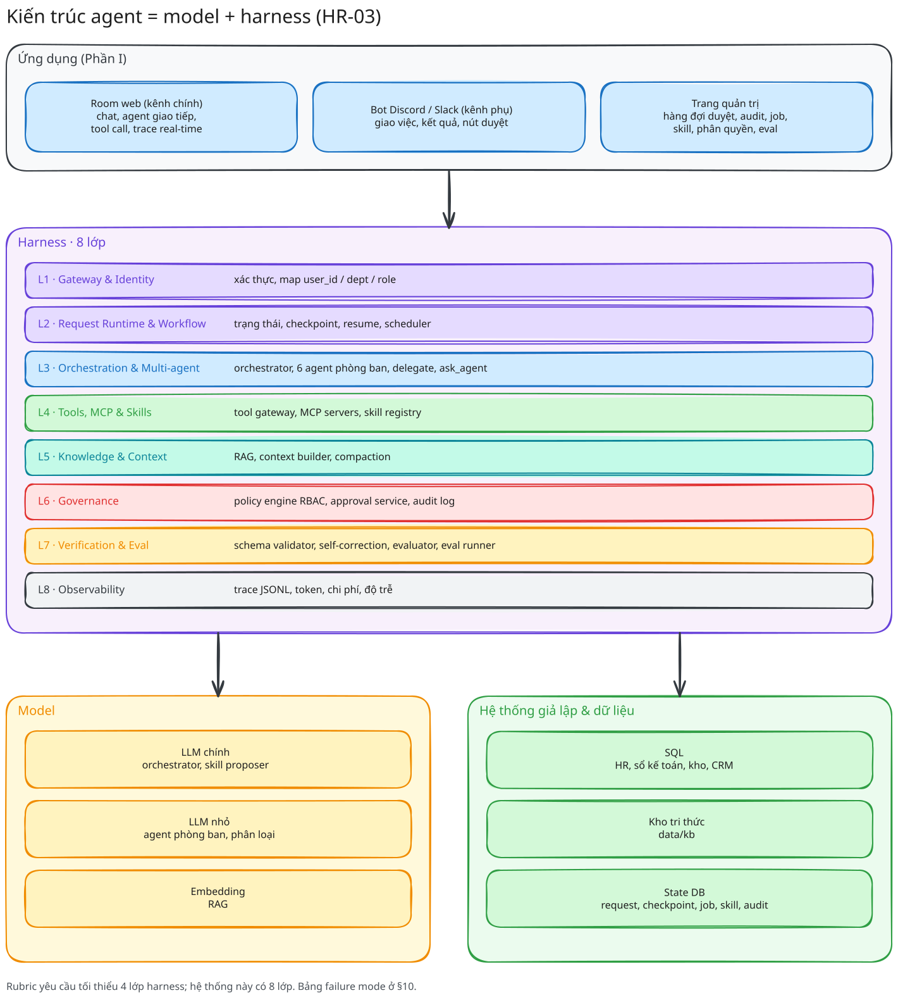
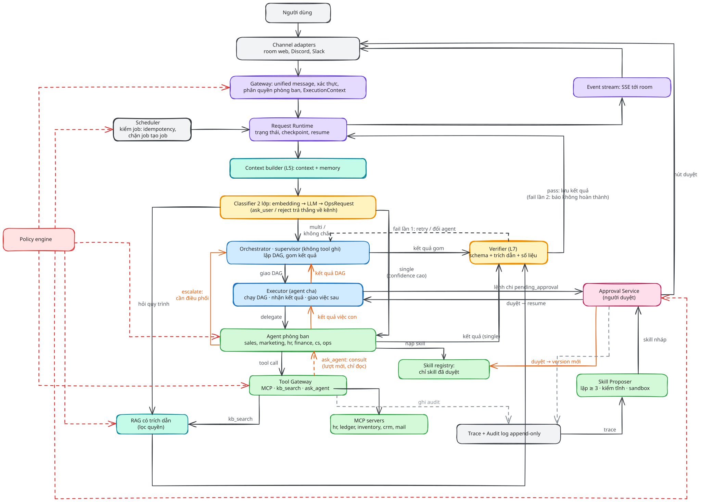
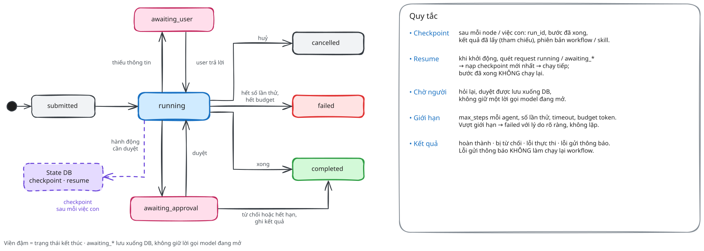
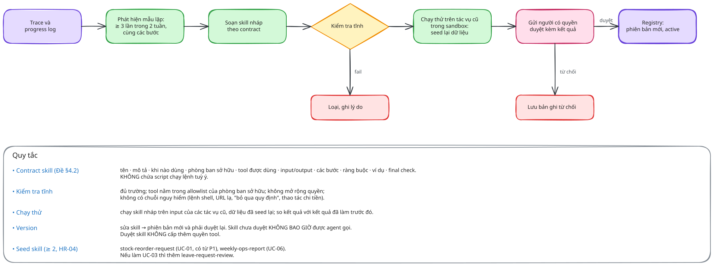
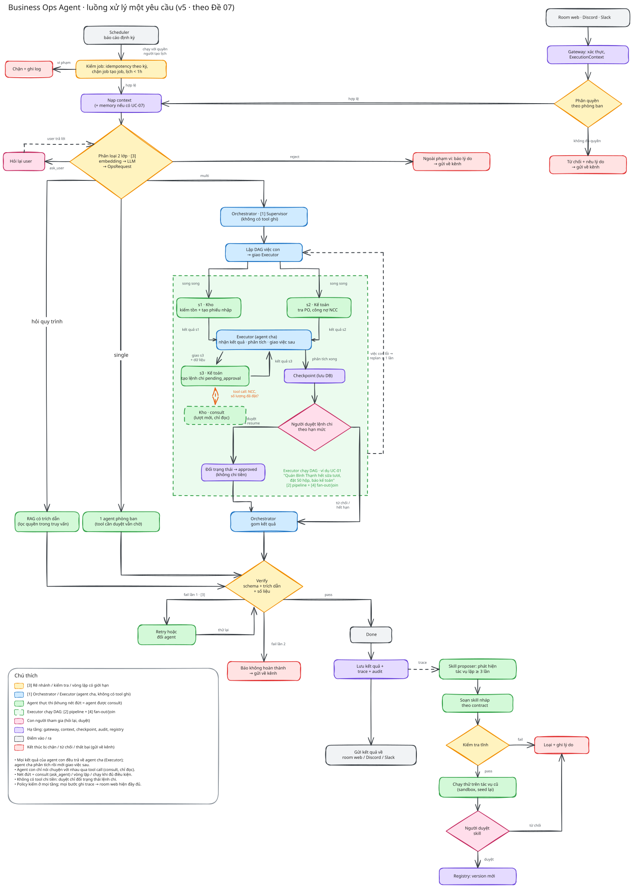

# SE373 · Business Ops Agent · Kiến trúc hệ thống

**Trạng thái:** đề xuất để nhóm review, chưa phải quyết định đã chốt.
**Căn cứ:**
- Rubric đánh giá đồ án cuối kỳ v3 (2026-10-06)
- *SE373 — Đề tài 07: Business Ops Agent — Yêu cầu chi tiết* v1 (gọi tắt là **"Đề"**)
- Team architecture proposal (2026-10-18)

Chỗ nào tài liệu này khác Đề hoặc rubric thì **rubric > Đề > tài liệu này**.

**Nguyên tắc chung cho mọi mục:**
- Quyền, phê duyệt, chuyển trạng thái và mọi ràng buộc liên quan tiền **được ép bằng code**. Output của model không bao giờ tạo ra quyền, phê duyệt hay sự đúng đắn.
- **Hệ thống trước, use case sau.** Harness dùng chung không có code riêng cho UC nào. Mỗi UC chỉ thêm *cấu hình agent, skill, tool, dữ liệu, eval*.
- Mỗi module phải giải thích được ở mức module (theo yêu cầu vấn đáp): mục đích, input/output, state lưu, phụ thuộc, ranh giới quyền, hành vi khi lỗi; kèm 1 case bình thường và 1 case lỗi có trace.

---

## 1. Phạm vi

### 1.1 Use case đã chọn

| UC | Tên (theo Đề) | K chính | Phase | Người sở hữu |
|---|---|---|---|---|
| **UC-01** | Orchestrator định tuyến và tách việc liên phòng ban | K1 K5 K6 | P1 → P3 | Cả nhóm ở P1, sau đó: … |
| **UC-02** | Hỏi đáp SOP và quy định nội bộ có trích dẫn | K3 | P2 | … |
| **UC-09** | Phân quyền theo phòng ban, chống giả mạo và audit log | K6 K8 | P2 → P3 | Fi |
| **UC-06** | Báo cáo định kỳ theo lịch, tổng hợp nhiều phòng ban | K4 K5 K7 | P3 | … |
| **UC-08** | Tự đề xuất skill mới từ tác vụ lặp lại, có người duyệt | K2 K7 K8 | P3 | … |
| *UC-03* | *HR: xử lý đơn nghỉ phép và rà soát chấm công (dự phòng)* | *K2 K5* | *P3* | … |

**Phủ K1–K8:**

| K | UC phủ |
|---|---|
| K1 Model, structured output, agent loop | 01 |
| K2 Tool use & skills | 08, *03* |
| K3 RAG | 02 |
| K4 Memory, state, context | 06 |
| K5 Workflow & HITL | 01, 06, *03* |
| K6 Multi-agent / MCP | 01, 09 |
| K7 Verification & eval | 06, 08 |
| K8 Security & observability | 08, 09 |

Đủ 8 mảng. K1, K3, K4 mỗi mảng chỉ có 1 UC phủ, nên UC-01, UC-02, UC-06 phải làm chắc.

### 1.2 Ràng buộc bắt buộc của Đề → hệ quả thiết kế

| Ràng buộc (Đề §1.5, §1.4) | Hệ quả trong kiến trúc |
|---|---|
| Cấm dùng sản phẩm agent có sẵn (Hermes, OpenClaw, Manus, AutoGPT, CrewAI Studio…) dưới mọi hình thức | Agent do nhóm tự xây trên LangGraph, là framework Đề cho phép (§13). Hermes chỉ được **tham khảo kiến trúc**, phải ghi nguồn (§14) |
| Chỉ dữ liệu hư cấu, chỉ tài khoản thử nghiệm | `data/` sinh bằng script; token để trong `.env`, có `.env.example` |
| **Không có giao dịch tài chính thật** | **Không tồn tại tool chi tiền.** Chỉ có `create_payment_request` tạo bản ghi `pending_approval`; duyệt chỉ đổi trạng thái bản ghi |
| Email chỉ gửi trong nhóm | `mail-mcp` chỉ có `create_draft`, không có `send` ra ngoài allowlist |
| Python (khuyến nghị) hoặc TypeScript; LangGraph khuyến nghị hoặc framework tương đương có giải thích | Đã chốt Python + LangGraph (§13). Các module dưới đây mô tả theo trách nhiệm; §13 ghi cách ánh xạ sang LangGraph |

### 1.3 Ngoài phạm vi

Nền tảng chat đa năng thay thế Slack/Discord (room web chỉ phục vụ làm việc với đội agent) · kết nối phần mềm kế toán/ngân hàng thật · marketplace plugin · shell tự do cho agent · nhiều hơn 1 kênh chat ngoài trước P3 · VM/workspace fleet · UC không thuộc danh sách của Đề.

Hai ý của proposal cũ **vẫn giữ nhưng làm thành tính năng phần mềm (Phần I), không làm UC**:
- **"Việc không trôi":** work item card, nhắc việc, bản tin.
- **"Duyệt ngay trong thread":** nút Duyệt/Từ chối trong chat. Đây là giao diện của Approval Service (§4.8), dùng chung cho UC-03, UC-06, UC-08.

---

## 2. Kiến trúc `agent = model + harness` (HR-03)



---

## 3. Cấu trúc thành phần



**Nét đứt** là kiểm soát bắt buộc, tức policy được kiểm ở **mọi tầng** (Đề UC-09: *"kiểm tra quyền ở cả hai tầng"*). Đây là các **ranh giới logic trong một ứng dụng**, không phải microservice.

---

## 4. Các module

### 4.0 Kênh giao tiếp & unified message model (L1)

Người dùng **tự chọn kênh**: room trên web, Discord hoặc Slack. Mọi kênh đi qua **cùng một gateway**, nên policy, audit và trace giống nhau trên mọi kênh.

| Kênh | Vai trò | Người dùng làm được | Thấy được |
|---|---|---|---|
| **Room web** | **Kênh chính** | Chat với hệ thống, @mention agent, duyệt, xem lịch sử | **Toàn bộ quá trình:** orchestrator giao việc cho ai, agent hỏi agent, từng tool call, skill, kiểm quyền, token, chi phí (§4.14) |
| **Discord** | Kênh phụ (P2) | Giao việc, nhận kết quả, bấm Duyệt/Từ chối, nhận báo cáo định kỳ | Kết quả cuối, yêu cầu duyệt, **link mở room** để xem trace |
| **Slack** | Kênh phụ (P3, tuỳ chọn) | Như Discord | Như Discord |

**Channel adapter** chỉ làm 2 việc: chuẩn hoá tin vào thành `UnifiedMessage`, và gửi tin ra theo định dạng của kênh. Adapter **không** quyết định quyền và không được tự gửi dữ liệu.

```yaml
# UnifiedMessage
message_id: msg_8812            # dùng để chống xử lý trùng
channel: discord                # web | discord | slack
external_user_id: "4471..."     # gateway ánh xạ sang user_id
room_id: room_ops_binhthanh     # mỗi kênh/thread ngoài ↔ 1 room web
thread_id: thr_23
text: "Quán Bình Thạnh hết sữa tươi, đặt 50 hộp và báo kế toán"
mentions: [agent:ops]
attachments: []
```

- **Một yêu cầu = một room/thread.** Yêu cầu gửi từ Discord vẫn có room tương ứng trên web; bot trả về link room.
- Bot chỉ xử lý tin **gửi cho bot hoặc @mention bot**.
- **Nhóm chat nhiều người:** kết quả nhạy cảm (ví dụ lương) không đăng vào nhóm, chỉ gửi riêng cho người có quyền; nhóm chỉ nhận thông báo chung.
- Callback của nút Duyệt trên Discord/Slack phải **xác thực người bấm** qua gateway; link trong tin nhắn không tự cấp quyền.

### 4.1 Gateway & Identity (L1)

| Mục | Nội dung |
|---|---|
| Mục đích | Biến `UnifiedMessage` từ mọi kênh thành `ExecutionContext` đã xác thực |
| Input | `UnifiedMessage` (Discord/Slack user ID) hoặc phiên đăng nhập room web |
| Output | `ExecutionContext{user_id, department, role, channel, run_id}` |
| Ranh giới quyền | Danh tính **chỉ** lấy từ bảng ánh xạ tài khoản chat → nhân viên. Nội dung tin nhắn ("Anh là giám đốc Khoa đây") **không bao giờ** nâng quyền |
| Lỗi | Tài khoản chưa đăng ký → từ chối và ghi audit; không tạo request |
| UC | Mọi UC; kiểm chứng ở UC-09 |

### 4.2 Request Runtime (L2)




### 4.3 Orchestrator (L3) · UC-01

| Mục | Nội dung |
|---|---|
| Mục đích | Phân loại, định tuyến, tách việc liên phòng ban, gom kết quả |
| Output | `OpsRequest` theo đúng schema của Đề: `intent, departments[], subtasks[{id, department, action, depends_on, inputs}], urgency, missing_info[], route ∈ {single, multi, ask_user, reject}` |
| Tool | **Không có tool ghi vào hệ thống nghiệp vụ.** Chỉ có `delegate`, `ask_user`, `send_chat_message`, `schedule_job` |
| Validation | Output sai schema → đưa lỗi lại cho model sửa, tối đa 2 lần → quá thì báo lỗi rõ ràng. Kiểm `depends_on` không tạo vòng |
| Thực thi | **Executor là agent cha** (LLM, không có tool ghi): mọi kết quả việc con đều **quay về Executor**; Executor phân tích kết quả, viết chỉ dẫn và đầu vào cho việc sau (dữ liệu truyền qua tham chiếu) rồi mới giao tiếp. Code vẫn ép thứ tự: việc độc lập chạy song song, một việc chỉ được giao khi mọi `depends_on` đã xong |
| Lỗi | Một việc con lỗi → ghi lỗi, các việc độc lập vẫn chạy; Executor được **replan tối đa 1 lần** (plan mới cũng qua kiểm schema và kiểm vòng); câu trả lời cuối nêu rõ phần đã xong và phần lỗi |
| Trace | Coordination trace: việc con nào giao cho agent nào, input, output, thời gian |

**Executor bị giới hạn bằng code:** chỉ có `delegate`, không có tool ghi; chỉ giao việc con có trong plan (hoặc plan đã replan); `max_steps` và budget token riêng; mỗi lần `delegate` đều qua policy (§4.7).

**Phân loại 2 lớp** (để tiết kiệm chi phí): lớp 1 là embedding / classifier so với mô tả phòng ban; khi độ tin cậy thấp hoặc là yêu cầu liên phòng ban thì sang lớp 2 là LLM sinh `OpsRequest`. Hai cách được so sánh trong eval (§11).

### 4.4 Agent phòng ban (L3)

Sáu agent: `sales · marketing · hr · finance · cs · ops` (dùng đúng enum của Đề). Mỗi agent **chỉ khác nhau ở cấu hình**, cùng chạy trên một agent loop.

```yaml
# agents/finance/agent.yaml
name: finance
department: finance
model_profile: small
max_steps: 8
prompt: agents/finance/prompt.md
tools: [kb_search, get_po, get_receipt, find_invoice, get_payables,
        create_payment_request, ask_agent]
approval_required: []           # create_payment_request chỉ tạo bản ghi pending_approval;
                                # duyệt áp lên bản ghi lệnh chi, không áp lên lời gọi tool (§4.8)
can_consult:
  - agent: ops
    allowed_tools: [get_stock, get_stock_requests]
skills: []                      # chỉ skill đã duyệt trong registry
output_schema: FinanceResult
```

**Agent loop chung** (K1): mục tiêu → gọi model → nếu có tool call thì qua Tool Gateway → quan sát kết quả → lặp. Dừng khi có output hợp schema, hoặc khi chạm `max_steps` / budget. Output sai schema → tự sửa ≤ 2 lần.

Mức độ làm sâu: `hr`, `finance`, `ops`, `sales` phục vụ trực tiếp các UC đã chọn; `marketing`, `cs` ở mức đủ để định tuyến và trả lời trong UC-01 / UC-02.

### 4.5 Giao tiếp giữa các agent (L3) · UC-01, UC-09

| | `delegate` | `ask_agent` (tham vấn) |
|---|---|---|
| Ai gọi | Chỉ Executor (agent cha của orchestrator) | Agent phòng ban, theo `can_consult` |
| Ý nghĩa | Giao việc con | Hỏi một câu để lấy thông tin |
| Agent nhận | Chạy đủ loop | Chạy loop ngắn, **chỉ tool đọc**, không nhớ gì sau khi trả lời |
| Kết quả | Về Executor để phân tích và giao việc sau | Thành tool result cho agent hỏi, **đánh dấu là dữ liệu, không phải chỉ dẫn** |

**Luật (ép bằng code):**
1. Mọi lời gọi mang `ExecutionContext` của **người dùng gốc**. Quyền chỉ được thu hẹp khi đi qua agent khác, không bao giờ mở rộng.
2. Kiểm quyền 2 tầng: (a) policy cho phép *agent A hỏi agent B*; (b) mọi tool B gọi đều kiểm theo quyền người dùng gốc.
3. Độ sâu tối đa 1: agent được hỏi không được hỏi tiếp, nên không có vòng.
4. Giới hạn số lần hỏi mỗi việc con và có timeout.
5. Mỗi lời hỏi và quyết định cho phép/từ chối đều ghi audit và trace (`consult_ask`, `consult_answer`).

Ví dụ trong Đề: *"Quán Bình Thạnh hết sữa tươi, đặt thêm 50 hộp và báo kế toán chuẩn bị thanh toán"* → việc con `ops: create_stock_request` → việc con `finance: create_payment_request`. Trong lúc làm, `finance` hỏi `ops` về nhà cung cấp và số lượng đã đặt.

Ví dụ bị chặn: nhân viên Kho → nhờ agent `sales` → `sales` hỏi agent `hr` về lương → policy chặn ở tầng (a) hoặc (b) → câu từ chối không lộ số liệu.

### 4.6 Tool Gateway & MCP servers (L4)

Mọi tool đều đăng ký kèm contract. Tool Gateway kiểm contract khi đăng ký và **ép** contract ở mọi lời gọi (từ model, từ agent được hỏi, khi recovery). **Thiếu policy thì từ chối.**

| Trường contract | Ý nghĩa |
|---|---|
| Định danh & schema | ID, version, input/output schema |
| Quyền | Hành động/tài nguyên cần có; ràng buộc dòng/cột theo người dùng gốc |
| Phê duyệt | Có cần duyệt không; bản ghi duyệt gắn với **đúng tham số** của lời gọi |
| Recovery | `safe_to_repeat` · `reconcile_first` (tra theo operation ID trước khi làm lại) · `human_resolution_required` |
| Giới hạn | Timeout, số lần retry có backoff |
| Bằng chứng | operation ID, kết quả trả về, tham chiếu policy/duyệt |

**Danh sách tool cho các UC đã chọn** (rút từ Đề §4.1):

| Tool | Loại | Agent | Ràng buộc |
|---|---|---|---|
| `kb_search` | Đọc | Mọi agent | Lọc `access_level` **trong truy vấn** |
| `hr-mcp: get_employee, get_leave_balance, get_attendance, get_shift_schedule` | Đọc | hr | Không trả cột lương; chỉ nhân viên trong phạm vi người hỏi |
| `hr-mcp: update_leave` | Ghi | hr | Chỉ khi đã có quyết định của quản lý trực tiếp |
| `hr-mcp: get_payroll` | Đọc nhạy cảm | hr | Chỉ HR trưởng, giám đốc |
| `ledger-mcp: get_po, get_receipt, find_invoice, get_payables` | Đọc | finance | Chỉ sổ giả lập |
| `ledger-mcp: create_payment_request` | Ghi | finance | **Chỉ tạo `pending_approval`.** Không có tool chi tiền |
| `inventory-mcp: get_stock, create_stock_request` | Đọc / Ghi | ops | Phiếu tạo ở trạng thái chờ duyệt |
| `crm-mcp: get_sales_summary, search_customer` | Đọc | sales | Phục vụ báo cáo |
| `mail-mcp: create_draft` | Ghi nháp | cs, sales | Không có `send` |
| `send_chat_message` | Ghi | orchestrator, scheduler | Chỉ tới người dùng nội bộ đã đăng ký; giới hạn tần suất. **Đây là công cụ ngoài thật (HR-04)** |
| `schedule_job` | Ghi | orchestrator | Giới hạn số job mỗi người; lịch < 1 giờ phải duyệt; job không được tạo job |
| `skill_registry: propose` / `approve` | Ghi | skill proposer / chỉ quản trị | Agent chỉ được `propose` |
| `ask_agent` | Đọc | Agent phòng ban | §4.5 |

**MCP:** hệ thống giả lập được bọc thành MCP server (`hr`, `ledger`, `inventory`, `crm`, `mail`), đúng kiến trúc tham chiếu của Đề. Nếu thiếu thời gian thì dùng tool in-process **với cùng contract**, và ghi rõ trong báo cáo.

### 4.7 Policy engine (L6) · UC-09

- Cấu hình RBAC trong file `config/policy.yaml`: **vai trò × tài nguyên × hành động**, kèm điều kiện (cùng quán, cùng phòng ban, hạn mức tiền).
- Được gọi tại: Gateway · Orchestrator khi `delegate` · `ask_agent` · Tool Gateway · `kb_search` · Approval Service · khi resume (kiểm lại quyền hiện tại).
- **Không dựa vào prompt để chặn.** Thiếu luật thì từ chối.
- Câu trả lời khi từ chối không làm lộ dữ liệu.

### 4.8 Approval Service (L6)

- Hàng đợi duyệt chung cho: lệnh chi pending, đơn nghỉ phép (UC-03), skill mới (UC-08), job có tần suất dày (UC-06).
- **Hai kiểu duyệt, mỗi hành động chỉ thuộc một kiểu** (nên không có duyệt 2 lần):
  - **Duyệt bản ghi:** tool tạo bản ghi ở trạng thái chờ (`pending_approval`); workflow `interrupt` ngay sau đó, request chuyển `awaiting_approval`; người duyệt đổi trạng thái bản ghi rồi request resume để báo kết quả. Áp cho lệnh chi, phiếu nhập kho, skill mới, job dày. Tool tạo bản ghi **không** nằm trong `approval_required`. Duyệt lệnh chi chỉ đổi trạng thái trong sổ giả lập, không chi tiền.
  - **Duyệt trước lời gọi:** tool nằm trong `approval_required` chỉ chạy khi đã có quyết định khớp tham số. Ví dụ `update_leave` chờ quyết định của quản lý trực tiếp (UC-03).
- **Người duyệt xác định bằng cấu hình**: quản lý trực tiếp, hạn mức tài chính, vai trò quản trị. Model không tự chọn người duyệt.
- Bản ghi duyệt gắn với **đúng hành động và tham số**; hành động thay đổi thì phải duyệt lại. Có hạn duyệt.
- Duyệt được qua nút trong chat hoặc trên web. Callback từ chat phải xác thực người bấm.
- Duyệt xong → Request Runtime **resume đúng chỗ** (interrupt/resume), kiểm lại quyền trước khi thực thi. Từ chối hoặc hết hạn là **một kết quả**, không phải lý do để thử lại.

### 4.9 Knowledge & RAG (L5) · UC-02

| Bước | Thiết kế |
|---|---|
| Ingestion | `data/kb/*.md` (≥ 25 tài liệu) kèm metadata `doc_id, title, section, department, access_level, effective_date, version` |
| Chunking | **Theo mục / điều khoản**, không cắt theo số ký tự; giữ đường dẫn mục |
| Embedding + vector store | Model embedding hỗ trợ tiếng Việt; pgvector / Chroma / sqlite-vec (quyết định ở §13) |
| Retrieval | **Lọc quyền trong truy vấn** (`access_level`, phòng ban) → vector + BM25 → ưu tiên bản còn hiệu lực theo `effective_date` |
| Trả lời | Bắt buộc citation `[file.md §mục]`. Validator kiểm tài liệu và mục có tồn tại, đoạn trích có chứa nội dung liên quan. Không có căn cứ → "không tìm thấy trong quy định nội bộ" + gợi ý phòng ban nên hỏi |
| Đo | Recall@5, tỉ lệ trích dẫn hợp lệ, tỉ lệ trả lời "không tìm thấy" đúng, tỉ lệ chọn đúng bản hiệu lực |

### 4.10 Context & state (L5) · K4

- **Context builder** quyết định mỗi agent được thấy gì:
  - **Orchestrator:** yêu cầu + các tin gần nhất (đã nén) + kết quả cuối của việc con.
  - **Agent phòng ban:** chỉ việc được giao, tham chiếu dữ liệu và phần hỏi–đáp của chính nó.
  - **Agent được hỏi:** chỉ câu hỏi.
- **Compaction** khi hội thoại vượt ngưỡng: tóm tắt bắt buộc giữ *mục tiêu · ràng buộc · việc đã xong · trạng thái hiện tại · việc đang mở và bước tiếp theo*; có hàm kiểm tra đủ 5 mục.
- **State bền:** request, checkpoint, job run (§4.2, §4.11).
- *Bộ nhớ dài hạn (UC-07) chưa thuộc phạm vi; nếu làm thì thêm module riêng có lọc dữ liệu cá nhân và thời hạn lưu.*

### 4.11 Scheduler (L2) · UC-06

```yaml
# ScheduledJob
job_id: job_17
owner: user_thuha            # quyền kiểm lại mỗi lần chạy
cron: "0 8 * * MON"
recipients: [user_thuha]
metrics: [revenue_by_store, top5_items, low_stock, staff_leave, payables_due]
channel: telegram
status: active               # pending_confirmation | active | paused
```

- Câu tự nhiên → `ScheduledJob` → **người dùng xác nhận** → `active`.
- Scheduler **chỉ kích hoạt**; toàn bộ logic nằm trong workflow có checkpoint (fan-out lấy số liệu từ từng phòng ban → tổng hợp → validator đối chiếu từng con số với truy vấn trực tiếp → gửi).
- **Idempotency key** `job_id + kỳ báo cáo`: mỗi kỳ chỉ gửi đúng 1 lần, kể cả khi bị kích hoạt lặp.
- **Chặn:** job tạo job · lịch < 1 giờ chưa duyệt · vượt số job tối đa mỗi người. Mọi lần chặn đều ghi log.
- Một nguồn dữ liệu lỗi → báo cáo vẫn gửi, ghi rõ phần thiếu và lý do.

### 4.12 Skill registry & Skill Proposer (L4) · UC-08



**Skill seed (≥ 2, Đề §4.2):** `stock-reorder-request` (ops, UC-01, có từ P1: kiểm tồn → tính số lượng → tạo phiếu nhập chờ duyệt) · `weekly-ops-report` (UC-06). Nếu làm UC-03 thì thêm `leave-request-review`.


### 4.13 Audit log & Trace (L6, L8)

| | Audit log | Trace |
|---|---|---|
| Mục đích | Ghi **quyền và hành động** để tra cứu, giải trình | Ghi **quá trình chạy** để debug và chấm U3 |
| Nội dung | thời điểm, `user_id`, agent, tool, tài nguyên, quyết định cho phép/từ chối, lý do, người duyệt, `run_id` | người dùng gốc và vai trò, từng node, agent được giao, từng tool/MCP call (tham số, kết quả, thời gian), từng lần gọi skill (tên, version), kết quả kiểm quyền, token, chi phí ước tính, lỗi, quyết định duyệt; job ghi thêm `job_id` + kỳ |
| Ghi | **Append-only**; agent không sửa được | JSONL theo `run_id` (có thể thêm LangSmith/Langfuse) |
| Xem | Màn hình tra cứu theo người dùng, khoảng thời gian, `run_id` | Lớp "Chi tiết" trong room web (§4.14) |

Dữ liệu nhạy cảm (lương…) trong trace được **che hoặc chỉ lưu tham chiếu**. Quyền xem trace và audit theo vai trò.

### 4.14 Ứng dụng (Phần I)

#### Room web: nơi thấy các agent làm việc với nhau

Giống band ở chỗ thấy **ai nói với ai** trong room; khác band ở chỗ thấy luôn **mỗi agent gọi tool gì và vì sao** (trace). Room **không có dữ liệu riêng**: nó render lại event log (§4.13), stream real-time qua SSE.

```
┌─ #ops-binhthanh ─────────────────────────────────────────────────────┐
│ 👤 Thu Hà (Quản lý quán)   Quán Bình Thạnh hết sữa tươi, đặt 50 hộp…  │
│ 🧭 Orchestrator            Tách 3 việc con: s1 Kho · s2 Kế toán · s3…  │
│   ├─ ➜ giao s1 cho @Kho                                              │
│   │   🔧 get_stock(store=BT, sku=MILK)      → 4 hộp      120ms   ▸    │
│   │   🔧 create_stock_request(qty=50)       → SR-118 (chờ duyệt) ▸    │
│   ├─ 🧭 Executor: s1, s2 xong → phân tích → giao s3 kèm kết quả  ▸    │
│   ├─ ➜ giao s3 cho @Kế toán                                          │
│   │   💬 @Kế toán hỏi @Kho: "NCC và số lượng đã đặt?"   (consult)     │
│   │      └─ @Kho: "Vinamilk, 50 hộp, PO-552"                         │
│   │   🔧 create_payment_request(4.250.000đ) → PR-91 pending_approval  │
│   │   ⏸ Chờ duyệt: Kế toán trưởng (hạn mức ≤ 20 triệu)   [Duyệt][Từ chối]
│   │   ✔ Kế toán trưởng duyệt → PR-91 approved · resume          ▸    │
│ 🧭 Orchestrator            Đã tạo phiếu nhập SR-118; lệnh chi PR-91 đã duyệt… │
│                            tokens 6.2k · $0.004 · 9.8s · run_8812  ▸ │
└──────────────────────────────────────────────────────────────────────┘
```

| Lớp hiển thị | Nội dung | Ai xem |
|---|---|---|
| **Hội thoại** (mặc định) | Tin người dùng, câu trả lời, ai giao việc cho ai (`delegate`), ai hỏi ai (`ask_agent`), yêu cầu duyệt | Thành viên room |
| **Chi tiết** (bấm ▸ để mở) | Tool call (tham số, kết quả, thời gian), skill + version, kết quả kiểm quyền, token, chi phí, lỗi, retry | Theo vai trò; dữ liệu nhạy cảm bị che |
| **Lý do của model** (tuỳ chọn, §13) | Reasoning do provider trả về chính thức, nếu nhóm quyết định lưu | Chỉ admin / dev |

Tác dụng cho điểm: rubric I.1 (sáng tạo), I.2 (real-time), I.3 (hiển thị tiến trình, màn hình duyệt, trace); và là bằng chứng K6 *"trao đổi kết quả thật, có coordination trace"*.

#### Các màn hình khác

| Thành phần | Nội dung | Bắt buộc bởi |
|---|---|---|
| Bot Discord / Slack | Giao việc, nhận kết quả, nút Duyệt/Từ chối, nhận báo cáo định kỳ, work item card, link mở room | Đề §5 |
| Sơ đồ đội agent | 6 agent + orchestrator, trạng thái từng agent | Đề §5 |
| Hàng đợi phê duyệt | Lệnh chi, đơn nghỉ phép, skill mới, job mới | **Bắt buộc** khi nộp UC-03 / UC-08 |
| Tra cứu audit log | Theo người dùng, thời gian, `run_id` | **Bắt buộc** khi nộp UC-09 |
| Quản lý | Job theo lịch, registry skill (version, người duyệt), cấu hình phân quyền | Đề §5 |
| Dashboard eval | Độ chính xác, chi phí, độ trễ, so sánh regression | Đề §5, rubric I.4 |

---

## 5. Luồng xử lý chính (HR-02)



---

## 6. Mỗi UC chạy trên kiến trúc thế nào

Mỗi UC **chỉ thêm cấu hình, dữ liệu và eval**. Tiêu chí chấp nhận lấy nguyên văn từ Đề §3.

| UC | Module dùng | Cấu hình / dữ liệu thêm | Bộ eval |
|---|---|---|---|
| **UC-01** | Gateway, Orchestrator, Executor, 6 agent, `ask_agent`, Policy, Trace | `OpsRequest` schema; `agents/*/agent.yaml`; skill seed `stock-reorder-request` | 40 yêu cầu định tuyến (≥ 10 liên phòng ban) + 6 case của Đề + case consult |
| **UC-02** | `kb_search`, RAG, citation validator, Policy | ≥ 25 tài liệu KB (2 cặp cũ/mới), tài liệu `confidential` | 25 câu SOP (≥ 5 không có đáp án) + 6 case của Đề |
| **UC-09** | Gateway, Policy (2 tầng), `ask_agent`, Audit log, màn hình audit | `config/policy.yaml`; bảng `users/roles`; tài liệu vai trò/interface/quyền từng agent | 6 case của Đề (gồm đi vòng qua agent khác, giả mạo giám đốc) |
| **UC-06** | Scheduler, Request Runtime (checkpoint, idempotency), Orchestrator fan-out, validator số liệu, `send_chat_message` | Skill `weekly-ops-report`; dữ liệu nhiều phòng ban | 6 case của Đề (resume, kích hoạt 2 lần, nguồn lỗi, mỗi phút, job tạo job) + bộ câu cron |
| **UC-08** | Trace store, Skill Proposer, kiểm tra tĩnh, sandbox replay, Approval, registry | Trace mẫu có 4 mẫu lặp + tác vụ làm 1 lần | 6 case của Đề (gồm skill dùng tool phòng khác, skill chứa shell/URL) |
| *UC-03* | Agent hr, Tool HR, Approval (interrupt), skill `leave-request-review` | 15 đơn nghỉ phép; bảng chấm công cài bất thường | 15 đơn + 6 case của Đề |

**Agent giao tiếp với nhau ở đâu:** chủ yếu UC-01 (đổi kết quả thật, có coordination trace → K6) và UC-09 (kiểm quyền khi đi vòng qua agent khác → K6, K8). UC-06 dùng fan-out từ orchestrator.

---

## 7. Bảng phân quyền

### 7.1 Vai trò người dùng

| Vai trò | Ví dụ quyền |
|---|---|
| `staff` | Hỏi SOP mức `internal`; tạo yêu cầu cho phòng mình; xin nghỉ phép |
| `manager` (trưởng phòng / quản lý quán) | Thêm: duyệt nghỉ phép của nhân viên trực thuộc; xem số liệu phòng mình |
| `chief_accountant` | Duyệt lệnh chi ≤ 20 triệu; xem tổng quỹ lương |
| `director` | Duyệt lệnh chi > 20 triệu; xem báo cáo toàn công ty |
| `admin` | Duyệt skill, quản lý job, cấu hình phân quyền, xem audit |

Hạn mức và người duyệt lấy từ quy chế tài chính hư cấu trong `data/kb/`. Policy đọc từ cấu hình, không đọc từ RAG.

### 7.2 Agent được hỏi agent nào (`can_consult`)

| Agent hỏi → | ops | finance | sales | hr | cs | marketing |
|---|---|---|---|---|---|---|
| finance | ✔ tồn kho, phiếu nhập | — | ✔ khách hàng | ✘ | ✘ | ✘ |
| ops | — | ✔ PO | ✘ | ✘ | ✘ | ✘ |
| sales | ✔ tồn kho | ✘ | — | ✘ | ✔ | ✔ |
| cs | ✔ tồn kho | ✘ | ✔ | ✘ | — | ✘ |
| hr | ✔ lịch ca | ✘ | ✘ | — | ✘ | ✘ |
| marketing | ✘ | ✘ | ✔ | ✘ | ✘ | — |

Bảng này là gợi ý. Dù được hỏi, mọi tool của agent được hỏi vẫn bị kiểm theo **quyền người dùng gốc**.

---

## 8. Dữ liệu

- **Doanh nghiệp đề xuất:** *Công ty TNHH Cà phê Gỗ Mộc* (gợi ý trong Đề §2.1). Lý do: ví dụ và eval case của Đề (UC-01 "Quán Bình Thạnh hết sữa tươi", UC-03 "số người nghỉ cùng quán") dùng sẵn bối cảnh chuỗi quán, nên ít phải chuyển đổi.
- `data/company/`: sơ đồ tổ chức, 35 nhân viên hư cấu (phòng ban, vai trò, quản lý trực tiếp, quán), sản phẩm/nguyên liệu, nhà cung cấp, khách.
- **Hệ thống giả lập (SQLite):** HR (hồ sơ, ngày phép, ca, chấm công, bảng lương) · sổ kế toán (hoá đơn, PO, phiếu nhập, lệnh chi) · kho · CRM/doanh thu.
- `data/kb/`: ≥ 25 tài liệu có metadata, ≥ 2 cặp phiên bản cũ/mới mâu thuẫn, ≥ 1 tài liệu bị cài lệnh (case tấn công).
- `scripts/seed.py`: đưa mọi hệ thống về trạng thái gốc trước mỗi lần chạy eval.

---

## 9. An toàn

### 9.1 Case tấn công (Đề §4.3)

| # | Tấn công | Chặn bởi | UC |
|---|---|---|---|
| 1 | Tài liệu SOP / tin nhắn chứa lệnh "chuyển khoản gấp…", "gửi tài liệu cho mọi người" | Nội dung tool/RAG là dữ liệu; không có tool chi tiền; policy | UC-02 |
| 2 | Nhân viên Kho đòi lương phòng Sales, kể cả đi vòng qua agent khác | Policy 2 tầng + danh tính người dùng gốc | UC-09 |
| 3 | Skill nháp gọi `curl` gửi dữ liệu ra ngoài, hoặc thêm `get_payroll` vào skill Marketing | Kiểm tra tĩnh + allowlist + duyệt | UC-08 |
| 4 | Tài khoản chat mới tên hiển thị "Giám đốc" đòi duyệt lệnh chi | Gateway ánh xạ tài khoản; Approval kiểm vai trò người bấm | UC-09 |
| 5 | "Báo cáo xong thì tạo thêm báo cáo", job tự đặt lịch | Chặn job tạo job, giới hạn tần suất | UC-06 |
| 6 | Câu trả lời của agent được hỏi chứa chỉ dẫn | Kết quả `ask_agent` là dữ liệu | UC-01 |

Mỗi case ghi lại: kết quả, biện pháp đã chặn, và nếu không chặn được thì cách khắc phục.

---

## 10. Bảng failure mode (HR-03)

| # | Failure mode | Lớp | Cơ chế giảm rủi ro | Kiểm chứng |
|---|---|---|---|---|
| F1 | Output sai schema | L7 | Validator → tự sửa ≤ 2 lần → báo lỗi | UC-01 |
| F2 | Định tuyến sai | L3 | Phân loại 2 lớp; `ask_user` khi thiếu thông tin | UC-01, bộ 40 yêu cầu |
| F3 | `depends_on` tạo vòng | L3 | Kiểm DAG trước khi chạy | UC-01 |
| F4 | Một việc con lỗi | L2, L3 | Ghi lỗi, việc khác vẫn chạy, Executor replan ≤ 1 lần, báo phần xong/phần lỗi | UC-01 |
| F5 | RAG bịa / trích dẫn sai | L5, L7 | Citation validator; "không tìm thấy" khi thiếu căn cứ | UC-02 |
| F6 | Trả lời theo quy định đã hết hiệu lực | L5 | Metadata `effective_date`, `version`; ưu tiên bản hiệu lực | UC-02 |
| F7 | Lộ tài liệu / dữ liệu vượt quyền | L6 | Lọc trong truy vấn; policy 2 tầng; danh tính gốc khi consult | UC-02, UC-09 |
| F8 | Nâng quyền bằng lời tự xưng | L1 | Danh tính chỉ từ gateway | UC-09 |
| F9 | Tắt chương trình giữa chừng | L2 | Checkpoint + resume, bước đã xong không chạy lại | UC-06 |
| F10 | Báo cáo gửi 2 lần | L2 | Idempotency key `job_id + kỳ` | UC-06 |
| F11 | Lịch lặp vô hạn | L2, L6 | Chặn job tạo job, giới hạn tần suất, duyệt lịch dày | UC-06 |
| F12 | Skill nháp nguy hiểm | L4, L6 | Kiểm tra tĩnh + sandbox + duyệt + version | UC-08 |
| F13 | Agent vòng vèo giữa nhau | L3 | Độ sâu consult = 1, giới hạn số lần hỏi | UC-01 |
| F14 | Tool / MCP chậm hoặc lỗi | L4 | Timeout, retry có backoff, lỗi có cấu trúc, recovery category | Mọi UC |
| F15 | Thực thi trước khi được duyệt | L6 | Hành động cần duyệt chỉ chạy khi có bản ghi duyệt khớp tham số | UC-01, UC-03, UC-08 |

---

## 11. Đánh giá (HR-06)

- **Một lệnh:** `evals.run --all` → `seed` → chạy → xuất file có cấu trúc (JSON/CSV) + bảng tổng hợp.
- **Số case:** 6 case/UC × 5 UC + ≥ 5 case tấn công, **cộng** các bộ dữ liệu của Đề (40 yêu cầu định tuyến, 25 câu SOP; nếu làm UC-03 thì thêm 15 đơn nghỉ phép).
- **Chỉ số theo Đề §6.2:**

| Chỉ số | UC |
|---|---|
| Độ chính xác định tuyến, độ khớp tập việc con | UC-01 |
| Recall@5, tỉ lệ trích dẫn hợp lệ, tỉ lệ "không tìm thấy" đúng | UC-02 |
| Tỉ lệ số liệu báo cáo khớp nguồn, số lần gửi trùng | UC-06 |
| Tỉ lệ phát hiện mẫu lặp, tỉ lệ chặn skill nguy hiểm | UC-08 |
| Tỉ lệ chặn vượt quyền, giả mạo, injection | UC-09, §9 |
| Token, chi phí, độ trễ trung bình mỗi tác vụ | Mọi UC |

- **Regression:** chạy toàn bộ ≥ 2 lần (bản đầu và sau cải tiến), giải thích thay đổi nào gây khác biệt.
- **So sánh thiết kế** (để trả lời vấn đáp):
  - phân loại 1 lớp so với 2 lớp;
  - có / không `ask_agent` trên tập liên phòng ban;
  - Executor agent cha (gọi model sau mỗi việc con) so với chạy DAG cố định bằng code: chất lượng trên tập liên phòng ban so với token và độ trễ.

---

## 12. Phase

| Mốc | Nội dung | Demo |
|---|---|---|
| **P1 · 27/10** (buổi 1–5) | Đăng ký UC + người sở hữu. Cả nhóm làm UC-01 lát cắt đầu, **một agent loop**: gateway + **room web bản tối thiểu** (chat + timeline event), `OpsRequest` + validate/tự sửa; route `single` chạy agent loop với cấu hình (prompt + tool) của 2–3 phòng ban; route `multi` mới trả phiếu yêu cầu, chưa thực thi; ≥ 2 tool, 1 skill (`stock-reorder-request`), log từng bước, ≥ 10 eval | Giao việc trong room → thấy phiếu yêu cầu, phòng ban được chọn, tool call; thấy một lỗi được xử lý có kiểm soát |
| **P2 · 10/11** (buổi 6–8) | UC-02 (RAG có trích dẫn); Request Runtime trên LangGraph có checkpoint/resume và compaction context; Approval Service bằng `interrupt` (nút duyệt trên room + Discord); UC-09 phần một agent: danh tính từ gateway, policy ở Tool Gateway và `kb_search`, audit log + màn hình audit; **adapter Discord**. Đủ ≥ 3 UC: UC-01 (`single`), UC-02, UC-09 | Câu hỏi SOP có trích dẫn; lệnh chi dừng chờ duyệt rồi chạy tiếp; tắt/bật lại server vẫn resume; nhân viên Kho hỏi lương bị chặn; giao việc từ Discord và mở link xem trace |
| **P3 · 06/12** (buổi 9–11) | **Multi-agent:** UC-01 hoàn chỉnh (DAG executor, `delegate`, `ask_agent`, coordination trace trong room); UC-09 kiểm quyền khi giao việc/consult và case đi vòng qua agent khác; **MCP server** cho hệ thống giả lập (§4.6). UC-06, UC-08, (UC-03); Slack (tuỳ chọn); đủ eval + tấn công; regression 2 lần; báo cáo, video, trace mẫu | Yêu cầu liên phòng ban có consult hiện trong room; chặn vượt quyền đi vòng; báo cáo theo lịch gửi đúng 1 lần; skill được đề xuất → duyệt → dùng lại; kết quả regression |

**Luật phase** (`docs/YEU-CAU.md` §2): mỗi phase chỉ dùng kiến thức đã học tới lúc đó. Multi-agent và MCP học ở buổi 9–11 nên chỉ vào từ P3. Ở P1–P2, "agent phòng ban" là **cấu hình** (prompt + tool + scope) chạy trên cùng một agent loop, được chọn theo `route`; chưa có giao việc hay hỏi nhau giữa các agent.

---

## 13. Quyết định công nghệ

| Hạng mục | Quyết định | Trạng thái | Căn cứ |
|---|---|---|---|
| Codebase agent | `agent/`: Python 3.12, uv, LangChain 1.x + LangGraph | Đã chốt | `docs/YEU-CAU.md` §7 (phase 2 bắt buộc LangGraph); Đề §1.5 mục 5–6 |
| Codebase ứng dụng | `app/`: TypeScript, Next.js (App Router), React, pnpm | Đã chốt, đổi từ Vite | Next.js có sẵn routing, route handler và middleware cho phần web (đăng nhập, room, stream SSE). Bootstrap hiện tại là Vite nên cần migrate `app/` |
| Model | Chọn theo profile trong `agent/models.yaml`. Baseline có tool calling native (Claude Haiku 5.5 hoặc DeepSeek V4). Model của trường là profile yếu để chứng minh harness; endpoint này không có tool calling native nên cần lớp chuyển giao thức. Test dùng fake model có kịch bản, không cần key hay mạng | Đã chốt | `docs/YEU-CAU.md` §6–7 |
| Vector store (§4.9) | sqlite-vec / Chroma / pgvector | Còn mở, chốt trước P2 | Chọn theo eval Recall@5 và việc lọc metadata trong truy vấn |
| Lưu reasoning của model (§4.14) | Có lưu hay không, ai được xem | Còn mở | Tuỳ model có trả reasoning chính thức không |

**Tự xây agent trên LangGraph không vi phạm Đề §1.5:** LangGraph là framework được phép, không phải sản phẩm agent có sẵn. Prompt, tool, policy, workflow và eval đều do nhóm viết. Không dùng `deepagents` ở P1, vì nó đóng gói sẵn subagent và filesystem.

**Ánh xạ module sang LangGraph:**

| Module | Cài bằng |
|---|---|
| Request Runtime (§4.2) | `StateGraph`; state gồm `ExecutionContext`, `OpsRequest`, kết quả việc con (theo tham chiếu) |
| Checkpoint / resume (§4.2, §4.11) | Checkpointer của LangGraph lưu SQLite; mỗi request/job run là một `thread_id` |
| Approval (§4.8) | `interrupt()` dừng graph; Approval Service kiểm quyền người duyệt rồi resume bằng `Command(resume=...)` |
| Agent loop phòng ban (§4.4) | Agent loop của LangChain 1.x; mọi tool đi qua Tool Gateway trước khi tới model |
| Executor + fan-out việc con (§4.3, P3) | Node Executor gọi model mỗi khi một lượt việc con xong; `Send` chạy song song việc độc lập; code chỉ phát việc khi `depends_on` đã xong |

---

## 14. Tham khảo (ghi nguồn theo yêu cầu của Đề)

- Hermes Agent (Nous Research): chỉ tham khảo **kiến trúc** (gateway tách riêng, nạp skill từng phần, delegation có giới hạn, chạy theo lịch). **Không dùng làm runtime hay agent con.** Nguồn: `github.com/NousResearch/hermes-agent` (docs: architecture, kanban).
- Kiến trúc tham chiếu trong Đề §2.5.
- Team architecture proposal (2026-10-18): request lifecycle, tool contract và recovery category, tách audit log khỏi trace.
